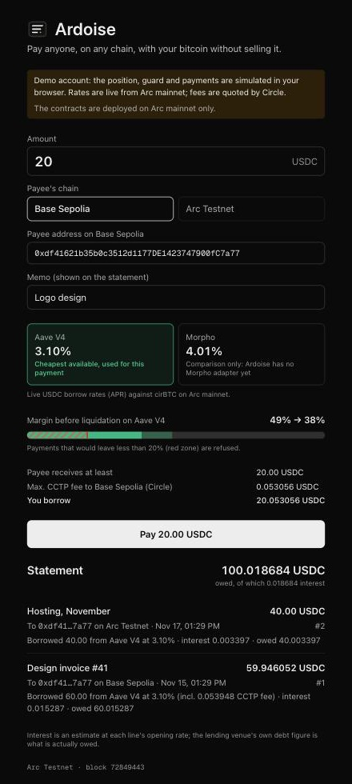
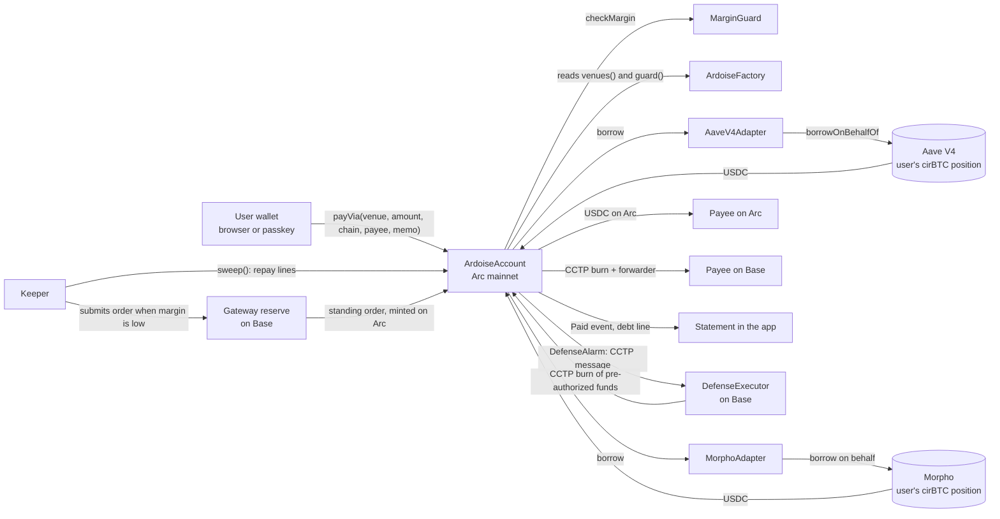

#  Ardoise

> **A defense agent for your bitcoin credit.** You give Ardoise a mandate; it pays from your bitcoin without selling it, defends your position with your dollars on other chains, and the contracts make anything outside the mandate impossible ([the admin's settings](#economic-design-and-risk-assumptions) aside).

Each payment borrows exactly its amount against your cirBTC on Arc and delivers it on Arc or on Base. When bitcoin falls, a guard refuses risky payments and a keeper repays from your reserve: on Arc mainnet it repaid 17 seconds after it first saw a simulated drop.

Built for **UBC Hackathon 2026 (University Blockchain Conference, UT Austin)**, tracks *DeFi & Onchain Apps* and *Best use of Arc*. Running on **Arc mainnet** with real cirBTC collateral on Aave V4 and Morpho.

## Demo

- Live app: **https://ardoise-rust.vercel.app**, on Arc mainnet. The landing page opens with a scroll-driven intro (the ring of collateral vaults with the live cirBTC rate, then borrowing, paying and protection); its **Access** button leads to the main page, where **My position** (or [`/app`](https://ardoise-rust.vercel.app/app)) opens on a demo account simulated in the browser, with live lending rates and Circle fee quotes from mainnet; with a wallet that holds cirBTC collateral on Aave V4 on Arc mainnet, **Connect wallet** activates a real account. Standing orders cannot be signed there, since the keeper's order intake only listens locally.
- Demo video: _coming soon_
- Try it locally in 2 minutes: see [Try it in 2 minutes](#try-it-in-2-minutes).



*The app on the demo account: live rates from Arc mainnet and the margin before and after the payment, beside the statement.*

A real payment made from the app on Arc mainnet (2026-11-18):

| Step | Transaction |
|------|-------------|
| `pay()`: 0.40 USDC to a payee on Base, 0.45523 USDC borrowed on Aave V4 (CCTP fee included), debt line #1 | [Arc explorer](https://explorer.arc.io/tx/0x9dfdd3d8ba60968a8feaed312edd03ad8c238850e89ec3af05cb3aa8b5836aed) |
| USDC minted to the payee on Base by Circle's forwarder, 4 seconds later (block timestamps) | [Basescan](https://basescan.org/tx/0x80d15046477b5332f3c55150b82dfeba38dbb97e15af9e70d792ffa266408a4b) |
| 0.10 USDC sent to the account, then `sweep()` by the keeper 3 blocks later repays it against line #1 | [transfer](https://explorer.arc.io/tx/0x578f203c3bdc3ea4b11c4d9c1862cd7b24627b28f00e71eb7e35d118c1402466), [sweep](https://explorer.arc.io/tx/0xe68ac63117e4ad5fee25fa63c8f7b70927dcdcca9b283f8201b2490247cf929a) |

The defense, on Arc mainnet (2026-11-18), with a simulated 55% bitcoin drop announced as such: **17 seconds** from the keeper's first reading to the repayment, including a transfer from Base through Circle Gateway. Arc blocks are final once produced, so each step counts as soon as it lands.

| Step | Transaction |
|------|-------------|
| A 0.20 USDC payment is refused by the guard: the simulated health factor (1.087) is under the 1.25 minimum | [refused `pay()`](https://explorer.arc.io/tx/0x433455e25f1b9c35da979a996f9d798270a41ae353a00e63a48c568ef3c51fa9) |
| The keeper submits one of the owner's Gateway standing orders; Circle's forwarder mints 0.40 USDC from Base on the account | [mint on Arc](https://explorer.arc.io/tx/0x39ef15e9635ef1500b2690bc2b452e6cab6d0b1ff32f81b153692ffd8cef6253) |
| The keeper calls `sweep()`, which repays 0.40 USDC on Aave V4: the simulated health factor goes back above the 1.5 target | [sweep](https://explorer.arc.io/tx/0x420afd89cbf7f80882be56c1b4f2328e7068a75421d2876d15a113a3a6a0da24) |

## The problem

Paying with bitcoin usually means selling it, which loses the exposure and, in the US, triggers capital gains tax. Borrowing against it avoids both, but today it is a loan you manage by hand: pick a lender, watch your margin, repay before you get liquidated.

On Arc, Circle's [Borrow Kit](https://docs.arc.io/app-kit/borrow) lends USDC against cirBTC through a single lender, Morpho, and leaves liquidation to Morpho. Yet the same collateral can borrow cheaper elsewhere: on 2026-11-17, the base USDC borrow rate against cirBTC was 3.10% a year on Aave V4 and 4.04% on Morpho, both on Arc mainnet (Aave adds a per-user risk premium on top of its base rate).

## The solution

Ardoise turns a cirBTC position on Arc into a payment account with an agent that defends it.

**The mandate.** The owner sets the limits; the contracts enforce them, whoever asks, except the factory admin, who sets the guard and the venues every account uses (see *Trusted admin* under [risk assumptions](#economic-design-and-risk-assumptions)):

| The agent may | The contracts make impossible |
|---------------|-------------------------------|
| Borrow USDC for a payment the owner signs, within the caps per payment and per day | A payment by anyone but the owner, or above the caps ([`ArdoiseAccount.sol`](contracts/src/ArdoiseAccount.sol)) |
| Borrow only while the margin stays above the guard's minimum | A payment that would push the health factor under 1.25 ([`MarginGuard.sol`](contracts/src/guard/MarginGuard.sol)) |
| Borrow on the lending venues the factory lists and the owner accepted, within the allowance the owner granted | Borrowing for another user, or withdrawing the cirBTC collateral ([`AaveV4Adapter.sol`](contracts/src/venues/AaveV4Adapter.sol)) |
| Repay debt with USDC sent to the account, from any caller | The keeper doing anything but repaying: `sweep()` can only reduce debt, and its wallet holds no other right |
| Bring USDC from Base with the owner's Gateway standing orders | Sending those funds anywhere but the owner's own Ardoise account: the signed orders name it ([`keeper/src/intake.ts`](keeper/src/intake.ts)) |

What the agent does with it:

- **Pay from your bitcoin.** Enter an amount, a payee and their chain (Arc or Base). Ardoise borrows exactly that amount, plus the cross-chain fee, on the lending venue you pick, Aave V4 or Morpho, and delivers it: the pay screen recommends the cheapest one the guard allows. Your bitcoin is never sold and stays in your own lending position.
- **See the rates and your margin before you pay.** The pay screen compares the live USDC borrow rates of Aave V4 and Morpho on Arc, with each borrowable venue's liquidity and whether the guard allows this payment there, and shows how much margin the position keeps before and after the payment.
- **One line per payment.** The statement lists every payment as a debt line: amount, venue, rate, payee, memo and interest so far, built from the account's on-chain events. Each cross-chain payment has a tracking page that follows it until it lands on the payee's chain.
- **Defended across chains.** A position guard refuses any payment that would push the margin below a minimum. A keeper repays debt with the USDC sent to the account. From the Protection panel, the owner can also keep a USDC reserve in Circle Gateway on Base and sign standing orders that the keeper uses to repay when the margin gets too low, or repay from Base in one click (both run on Arc mainnet: a one-click repayment from Base swept 5 s after it landed, and an automatic repayment 17 s after a simulated price drop; see [`contracts/deployments.md`](contracts/deployments.md#state)).
- **Stress test before it happens.** Pick a scenario (for example bitcoin −40% and ether −50%) and see the health factor as bitcoin falls, with and without the keeper drawing on the reserve. The panel shows the reserve drawn in order, whether the position survives and the liquidation penalty it avoids, using Aave V4's cirBTC liquidation parameters read on Arc. The keeper only counts what it can actually draw: USDC on the account and the part of the Gateway reserve the standing orders cover. A breakdown lists the reserve asset by asset, including the rest of the Gateway balance and USDC and ETH in the wallet on Base, with ETH counted at its crisis value. It ends with the bitcoin drop the keeper covers, and the drop covered if the owner also moves the rest in time. A live account's reserve is read on chain; the demo account's is simulated. Everything is computed in the browser ([`app/src/lib/stress.ts`](app/src/lib/stress.ts), [`app/src/lib/reserve.ts`](app/src/lib/reserve.ts)).

Without a wallet, anyone can try the whole flow on a demo account simulated in the browser, with live rates from Arc mainnet and real Circle fee quotes. Connecting a wallet on Arc mainnet activates a real account. Instead of a browser wallet, a user can sign in with a passkey (Face ID, Touch ID, a security key): it owns a Circle smart account, which is activated and pays with one passkey signature each, with no seed phrase and no extension.

**What Ardoise adds to Borrow Kit:**

| | Borrow Kit | Ardoise |
|--|-----------|---------|
| Lenders | Morpho only | Aave V4 or Morpho, per payment: the cheapest venue the guard allows is recommended, the user may pick the other; both are deployed on Arc mainnet |
| When you borrow | One loan, by hand | Exactly the amount of each payment, at payment time |
| Where the money goes | Your wallet on Arc | The payee, on Arc or on another chain through CCTP |
| Liquidation | Warning, then Morpho liquidates | Guard refuses risky payments; keeper repays from the account, or from a Gateway reserve on Base (run on mainnet) |
| Record | Loan balance | One debt line per payment, with payee and memo |

## How it works



1. **One-time setup.** The user already has cirBTC supplied as collateral on Aave V4, in their own position (done on Aave). When they activate Ardoise, the app has them authorize Aave's position managers, create their `ArdoiseAccount` through the factory and give the adapter a capped borrow allowance ([`app/src/lib/setup.ts`](app/src/lib/setup.ts)). A passkey smart account receives its cirBTC by a plain transfer instead, and its activation supplies it on Aave V4, enables it as collateral and runs the other steps in a single user operation (`activationCalls`).
2. **Pay.** `payVia(venue, …)` borrows on the venue the user picked; `pay()` picks the cheapest one where the guard allows the payment (`bestVenue`, which the app recommends). Both check the account's caps and the guard on that venue, borrow `amount + maxFee` on the user's behalf, then either transfers USDC on Arc or burns it with CCTP so that Circle's forwarder mints it to the payee on the other chain. It records a debt line and emits `Paid` ([`contracts/src/ArdoiseAccount.sol`](contracts/src/ArdoiseAccount.sol)).
3. **Protect.** `MarginGuard` refuses payments that would leave the health factor under 1.25 ([`contracts/src/guard/MarginGuard.sol`](contracts/src/guard/MarginGuard.sol)). The keeper, an off-chain Node process, watches every account and calls the public `sweep()` to apply the USDC on an account to its debt, starting with the venue closest to liquidation (lowest health factor), oldest line first on each venue. When a position is under the minimum and the account holds nothing, it submits one of the owner's Gateway standing orders to bring USDC from Base, never for more than the debt left to repay minus the USDC already on the account ([`keeper/src/keeper.ts`](keeper/src/keeper.ts), [`keeper/src/gateway.ts`](keeper/src/gateway.ts)).
4. **Defend across chains.** When a position is under the minimum health factor, anyone (the keeper in practice) can call `DefenseAlarm.raise(owner)` on Arc, which sends a CCTP message; a relayer submits Circle's attestation of it to `DefenseExecutor` on Base, which can only spend what the owner pre-authorized there, and only to repay the owner's account on Arc ([`contracts/src/defense/`](contracts/src/defense/)). Each factory has its own alarm and executor. The current factory has two pairs, which pinned its venues and the guard's thresholds when they were deployed: a production pair that decides on the venues' real health factor, and a demo pair that also follows the guard's simulated drop, on which only the demo wallet holds a policy. The keeper relays the demo pair (see *Trusted admin* and *Demo simulation* under [risk assumptions](#economic-design-and-risk-assumptions)). The [mainnet proof](contracts/deployments.md#mainnet-proof) ran on earlier pairs and demo accounts: relayed by hand on the Aave-only factory (the repayment was minted on Arc 26 seconds after the alarm), then by the keeper alone on the factory with the Morpho venue.

The collateral never moves to Ardoise: the account can only borrow within the allowance the user granted and repay; it cannot withdraw cirBTC. The full payment sequence, the interfaces and their invariants are in [`docs/api.md`](docs/api.md).

## Built with Circle and Arc

Three Circle building blocks carry Ardoise: **CCTP** delivers payments to other chains and carries the defense alarm, **Gateway** brings the reserve from Base in seconds, and **Modular Wallets** let a passkey own the account. The details, file by file:

- **Arc mainnet:** the contracts are deployed on Arc mainnet (see [Deployed contracts](#deployed-contracts)) and every payment borrows on Arc's Aave V4 or Morpho market. Gas on Arc is paid in USDC, so the user needs no other token. The app quotes, simulates and sends `payVia()` on the venue on screen and reads the statement from the account's logs ([`app/src/lib/chainArdoise.ts`](app/src/lib/chainArdoise.ts)); the server keeps each account's history and the venue rates between requests, so visitors share Arc reads instead of each browser re-scanning the chain ([`app/src/lib/accountEvents.ts`](app/src/lib/accountEvents.ts), [`app/src/lib/cache.ts`](app/src/lib/cache.ts)), and the browser wallet signs on Arc ([`app/src/lib/wallet.ts`](app/src/lib/wallet.ts)). `NEXT_PUBLIC_ARDOISE_NETWORK` chooses Arc mainnet or Arc Testnet ([`app/src/lib/network.ts`](app/src/lib/network.ts)); the live USDC borrow rates of Aave V4 and Morpho are read on Arc mainnet through the deployed adapters ([`app/src/lib/venues.ts`](app/src/lib/venues.ts)).
- **Modular Wallets (passkeys):** a passkey owns a Circle smart account (MSCA) on Arc; the app signs in with `toWebAuthnCredential`, builds the account with `toCircleSmartAccount` and sends user operations through Circle's bundler ([`app/src/lib/passkey.ts`](app/src/lib/passkey.ts)). Activation batches every setup call into one user operation, and each payment is one user operation calling `payVia()` on the venue on screen. On Arc mainnet the account pays its own gas in USDC: Circle offers no paymaster there (test 0.2). The option appears when `NEXT_PUBLIC_CIRCLE_CLIENT_KEY` is set, and the SDK loads only when the user picks it. The same passkey's account on Base holds the Gateway reserve: it deposits in one user operation (which also deploys it there) and signs standing orders through ERC-1271, sent to Gateway with `contractSigner` ([`app/src/lib/gatewaySigner.ts`](app/src/lib/gatewaySigner.ts)). The SDK was tested on Arc mainnet in test 0.2 ([`docs/roadmap.md`](docs/roadmap.md)); the in-app passkey flow, on Arc and on Base, has not run on mainnet yet. The native iOS app does the same with Circle's iOS SDK (`CircleModularWalletsCore`): its associated domain is the web app's, so one passkey is meant to sign in on both (not verified yet), and it pays with `payVia` as one user operation ([`ios/Ardoise/Wallet/PasskeyWallet.swift`](ios/Ardoise/Wallet/PasskeyWallet.swift)); it has not run against mainnet yet.
- **USDC and cirBTC:** USDC is what each payment borrows and delivers; cirBTC, Circle's wrapped bitcoin on Arc, is the collateral in the user's Aave V4 position ([`contracts/src/venues/AaveV4Adapter.sol`](contracts/src/venues/AaveV4Adapter.sol)).
- **CCTP (Cross-Chain Transfer Protocol):** a payment to a payee on Base is burned on Arc with `depositForBurnWithHook` and minted on Base by Circle's forwarder ([`contracts/src/ArdoiseAccount.sol`](contracts/src/ArdoiseAccount.sol), [`contracts/src/cctp/ITokenMessengerV2.sol`](contracts/src/cctp/ITokenMessengerV2.sol)). The app tracks each delivery through Circle's attestation service (Iris): [`app/src/lib/delivery.ts`](app/src/lib/delivery.ts), shown on the payment page [`app/src/app/payments/[txHash]/page.tsx`](app/src/app/payments/[txHash]/page.tsx).
- **CCTP V2 generic messaging (defense alarm):** when a position is under the minimum health factor, anyone can call `DefenseAlarm.raise(owner)` on Arc, which checks it on chain and sends a message through Circle's MessageTransmitterV2. On Base, `DefenseExecutor` accepts only that finalized, Circle-attested message from the alarm; it then spends the funds the owner pre-authorized (USDC, then WETH sold on Uniswap within an oracle-bounded slippage) and burns them with CCTP to the owner's account on Arc. The relayer decides nothing ([`contracts/src/defense/`](contracts/src/defense/), [`docs/api.md`](docs/api.md)). It is tested against a Base mainnet fork and deployed on mainnet for the current factory in two pairs: production (`DefenseAlarm` on Arc at `0x71146B387B1dF474dd165d35b384A38E1a02813b`, `DefenseExecutor` on Base at `0xbb8c9935BFE2F15169E7195E212AB50134064E5B`), which reads the venues' real health factor, and demo (`0xFbd04d6263aDD461C523f34C8c3717Fb5c437545` and `0x7016D3D0a4DB22c6C2079C5e7172a1A4d2161f29`), which also honors the guard's simulated drop. The full mainnet runs were made on earlier pairs: the attestation was fetched from Iris (`/v2/messages`) and relayed to Base, first by hand, then by the keeper alone ([`contracts/deployments.md`](contracts/deployments.md#mainnet-proof)). The earlier pairs read the factory's venues and guard on every call; the demo wallet's policies on them were cleared on 2026-11-19 ([`contracts/deployments.md`](contracts/deployments.md#cctp-attested-defense-d1)).
- **CCTP fees:** before each payment to Base, the app asks Iris for the transfer and forwarder fee and borrows it on top of the amount (`maxFee` in `pay()`): [`app/src/lib/fees.ts`](app/src/lib/fees.ts).
- **Gateway:** the keeper repays debt from the user's Circle Gateway balance on Base through standing orders, signed burn intents that can only pay the user's own Ardoise account, delivered on Arc by Circle's forwarder: [`keeper/src/gateway.ts`](keeper/src/gateway.ts). Users deposit, sign orders and repay in one click from the app ([`app/src/lib/gateway.ts`](app/src/lib/gateway.ts), [`app/src/components/ProtectionPanel.tsx`](app/src/components/ProtectionPanel.tsx)), and the keeper checks each order before storing it ([`keeper/src/intake.ts`](keeper/src/intake.ts)); explained in [`docs/api.md`](docs/api.md#gateway-standing-orders-b4). Both the keeper path and the one-click path have run on Arc mainnet ([`contracts/deployments.md`](contracts/deployments.md#state)).

## Economic design and risk assumptions

**Who pays what.** Ardoise charges no fee of its own. The user pays:

- **Interest** at the venue's variable USDC borrow rate (3.10% a year on Aave V4 when the contracts were deployed), on the amount borrowed, until it is repaid.
- **The cross-chain fee** for payments outside Arc, quoted by Circle and borrowed on top of the amount. For example, 0.05523 USDC to deliver 0.40 USDC on Base, almost all of it the forwarder fee, which is flat: it weighs less on larger payments. Payments on Arc have no such fee.
- **Gas on Arc**, in USDC, for their own transactions. The keeper's `sweep()` gas is paid by the keeper's wallet.
- **Gateway fees** when a standing order is used: about 0.025 USDC quoted for a 5 USDC order from Base to Arc.

**Limits built into the contracts:**

- **Caps per account:** 10 USDC per payment and 20 USDC per UTC day by default (set on the factory), applied to the amount plus the fee. They keep the demo exposure small.
- **Guard thresholds:** a payment is refused if it would leave the health factor under **1.25** (Aave liquidates under 1.0); the keeper repays towards **1.5**.
- **Borrow allowance:** the user grants the adapter a finite allowance on Aave V4 (60 USDC for the demo account), never an unlimited one, since the adapter is shared by every account.

**Risks we assume:**

- **Market and oracle.** The guard reads Aave's own health factor and oracle. A bitcoin drop faster than the keeper can react, or a reserve that is too small, can still lead to liquidation by Aave: Ardoise lowers the risk, it does not remove it.
- **Keeper liveness.** The keeper is a single off-chain process run by the team. If it stops, positions are not repaid automatically; `sweep()` is public, so anyone can run one.
- **Gateway timing.** Gateway credits a deposit on Base only after Base finality (8 minutes to about 1.5 hours observed on testnet), so a fresh reserve cannot be used right away.
- **Variable rates.** Rates move with each block; the debt line stores the rate at payment time and its interest is an estimate. The venue's debt is what is actually owed.
- **Fees.** The whole `maxFee` is charged on CCTP payments even when Circle's actual fee is lower, so the app quotes it tightly from Iris.
- **USDC left on an account.** An account's USDC can only repay its owner's debt. If more arrives than is owed (a standing order larger than the debt, a transfer by mistake), or a venue refuses repayments, the rest stays on the account until the owner takes it back with the owner-only `withdraw(amount)` ([`ArdoiseAccount.sol`](contracts/src/ArdoiseAccount.sol), [details](docs/api.md#implementation-notes-ardoiseaccount-ardoisefactory)). Accounts of the earlier factories have no `withdraw`: there, the owner can only get it out by borrowing the same amount to themselves and letting `sweep()` repay it.
- **Trusted admin, one key.** The factory admin chooses the venues and the guard every account uses, and the guard's owner sets its thresholds and the simulated drop. For the hackathon, one project wallet, a browser-wallet key, holds both roles and also owns the demo accounts. Whoever controls it can list a venue that takes the USDC reaching an account when `sweep()` runs, replace the guard, or trigger repayments from users' Gateway reserves and defense funds within the limits each user set; it cannot withdraw collateral. The roles are immutable on the deployed contracts, and the 2026-11-19 redeployment kept the project wallet in both. The deploy scripts can now give them to a separate address (`ARDOISE_FACTORY_ADMIN`, `ARDOISE_GUARD_OWNER`): a multisig there is the first step before real users ([privileged roles](contracts/deployments.md#privileged-roles)). An account only borrows from, approves and pays venues its owner accepted: the factory's list when the account was created, then the venues the owner adds with `acceptVenue` ([`ArdoiseAccount.sol`](contracts/src/ArdoiseAccount.sol), [details](docs/api.md#implementation-notes-ardoiseaccount-ardoisefactory)), so the owner should read `acceptedVenues()` right after `createAccount()`. The defense alarms keep the venues and thresholds they pinned at deployment, so a later admin change does not reach them. The earlier pairs (alarm `0x7147a1aE19F0d1Ad0d2885baa55f2D0004D5B3B8` with executor `0x7294F4B0629C3dD7BCBA2ff074997982850Cb8d6`, and alarm `0x3BABC3f53E354284C98F272CC4E093730aA05E43` with executor `0x897B6baF462ae207895f2Cf32A0A4c6D98f15296`) followed the admin's choices on every call; the demo wallet cleared its policies on them on 2026-11-19.
- **Demo simulation.** For the demo, the guard's owner can simulate a bitcoin drop. It never touches Aave or its oracle, but it is global and it moves real funds: while it is on, payments are refused, the keeper repays earlier from each owner's reserve, and **anyone can call `raise` on the demo alarm (`0xFbd04d6263aDD461C523f34C8c3717Fb5c437545`) and trigger real spending (a sale of pre-authorized WETH on Base) for every owner holding a policy on the demo executor (`0x7016D3D0a4DB22c6C2079C5e7172a1A4d2161f29`)**: only the demo wallet holds one, and nobody else should. The production alarm (`0x71146B387B1dF474dd165d35b384A38E1a02813b`) ignores the simulation. The earlier executors would also act on it, which is why the demo wallet's policies on them were cleared. The drop must be set back to 0 after the demo (it ran on Arc mainnet on 2026-11-18, [transactions](contracts/deployments.md#state); [details](docs/api.md#price-drop-simulation-demo-only)).
- **Not audited.** The contracts were written during the hackathon week and have about 280 Foundry tests, but no audit. Use small amounts only.

## Deployed contracts

On **Arc mainnet** (chain id 5042); the factory, adapters, guard and defense alarms are verified on Sourcify, and so are the defense executors on Base (chain id 8453). Full deployment record, constructor arguments and checks: [`contracts/deployments.md`](contracts/deployments.md).

| Contract | Address |
|----------|---------|
| `ArdoiseFactory` | [`0x96359511A27830eDa8B5c663fE451eCf11ae1449`](https://explorer.arc.io/address/0x96359511A27830eDa8B5c663fE451eCf11ae1449) |
| `AaveV4Adapter` (USDC on the Aave V4 Main Spoke) | [`0xc07Ab03CC7E68a662124da695AF4Ea6745Dc6674`](https://explorer.arc.io/address/0xc07Ab03CC7E68a662124da695AF4Ea6745Dc6674) |
| `MorphoAdapter` (Morpho's cirBTC/USDC market) | [`0xf4F0009eFC9da4359f2d6A726F702B2F96749E03`](https://explorer.arc.io/address/0xf4F0009eFC9da4359f2d6A726F702B2F96749E03) |
| `MarginGuard` (minimum health factor 1.25, target 1.5) | [`0xEBAC5C07DC0983C01f55AbEAD77a3FcC7a4cf080`](https://explorer.arc.io/address/0xEBAC5C07DC0983C01f55AbEAD77a3FcC7a4cf080) |
| `DefenseAlarm`, production (real health factor) | [`0x71146B387B1dF474dd165d35b384A38E1a02813b`](https://explorer.arc.io/address/0x71146B387B1dF474dd165d35b384A38E1a02813b) |
| `DefenseAlarm`, demo (honors the simulated drop) | [`0xFbd04d6263aDD461C523f34C8c3717Fb5c437545`](https://explorer.arc.io/address/0xFbd04d6263aDD461C523f34C8c3717Fb5c437545) |
| Demo `ArdoiseAccount` | [`0x6Ce5C993328265425175cE044b0843F74aE98aB3`](https://explorer.arc.io/address/0x6Ce5C993328265425175cE044b0843F74aE98aB3) (earlier demo accounts, with the earlier mainnet runs: [`0x4d298b39…7a49`](https://explorer.arc.io/address/0x4d298b39F3676B07335206E7b7F042D51e787a49), [`0xdcB201E7…2bBD`](https://explorer.arc.io/address/0xdcB201E7dFCB1edaacB53043ca12558A260B2bBD)) |

On **Base mainnet**: `DefenseExecutor` production [`0xbb8c9935BFE2F15169E7195E212AB50134064E5B`](https://basescan.org/address/0xbb8c9935BFE2F15169E7195E212AB50134064E5B), demo [`0x7016D3D0a4DB22c6C2079C5e7172a1A4d2161f29`](https://basescan.org/address/0x7016D3D0a4DB22c6C2079C5e7172a1A4d2161f29).

## Getting started

### Try it in 2 minutes

The fastest way is the [live app](https://ardoise-rust.vercel.app), with nothing to install. To run it locally instead:

Needs Node.js 22.9 or later. No wallet and no `.env` file are required: the app opens on a demo account simulated in the browser, with live lending rates from Arc mainnet. Without `.env` the app runs in testnet mode, so payments go to Base Sepolia or Arc Testnet and the cross-chain fee is quoted by Circle's sandbox.

```bash
git clone https://github.com/enzoblain/Ardoise.git
cd Ardoise/app && npm install && npm run dev
```

Open http://localhost:3000 and scroll through the intro, click **Access**, then **My position** (or go to http://localhost:3000/app), enter an amount and a payee address, compare the rates, watch the margin gauge and click **Pay**: the payment appears as a new line in the statement.

### Prerequisites

- Node.js 22.9 or later, with npm
- [Foundry](https://book.getfoundry.sh/getting-started/installation) (`forge`), for the contracts only
- Xcode 26 and [XcodeGen](https://github.com/yonaskolb/XcodeGen) (`brew install xcodegen`), for the iOS app only

### Installation

```bash
git clone --recurse-submodules https://github.com/enzoblain/Ardoise.git
cd Ardoise
(cd app && npm install)
(cd keeper && npm install)
cp .env.example .env   # optional for read-only use: Arc reads default to the public RPC
```

The app and the keeper both read the `.env` file at the repository root; every variable is described in [`.env.example`](.env.example).

### Run

Run the front end and the keeper in two separate terminals, from the repository root:

```bash
(cd app && npm run dev)      # front end on http://localhost:3000
```

By default the app runs on Arc Testnet with a simulated demo account. To use the deployed contracts, set `NEXT_PUBLIC_ARDOISE_NETWORK=mainnet` in the root `.env`, open the app with a browser wallet that holds cirBTC collateral on Aave V4, click **Connect wallet** and follow the one-time activation (Aave position managers, account creation, borrow allowance). To offer passkeys, also set `NEXT_PUBLIC_CIRCLE_CLIENT_KEY` to a Circle client key whose passkey domain is the app's host (`localhost` for local runs); the passkey's smart account needs cirBTC and some USDC for gas before its activation (the app asks for at least 0.5 USDC: in test 0.2, a single transfer needed a 0.106 USDC prefund and finally cost about 0.04 USDC).

```bash
(cd keeper && npm start)     # keeper, polls Arc mainnet for new blocks
```

To let users sign Gateway standing orders from the app's Protection panel, set `GATEWAY_ORDERS_FILE` and `GATEWAY_INTAKE_PORT` (for example `8787`) for the keeper and `NEXT_PUBLIC_KEEPER_URL=http://localhost:8787` for the app. The intake listens on `127.0.0.1` only, so the app must run in a browser on the keeper's machine.

The iOS app (`ios/`) is a native SwiftUI client of the same contracts, signed in with the same passkey as the web app. Copy `ios/Local.example.xcconfig` to `ios/Local.xcconfig` and set a Circle **iOS** client key (created in the Circle Console for the bundle ID `com.enzoblain.ardoise`, with the same passkey domain; the web app's key is refused), then open `ios/Ardoise.xcodeproj` (or regenerate it with `cd ios && xcodegen`) and run the **Ardoise** scheme. It needs an Apple team whose app ID is listed in the site's [`apple-app-site-association`](app/public/.well-known/apple-app-site-association) (currently `V89X9X5JFK.com.enzoblain.ardoise`; another team must change it there and in `ios/project.yml`). Xcode 27 beta does not build web3swift 3.3.2, a dependency of Circle's SDK: use Xcode 26 (not yet verified; the app was built and run on Xcode 27 beta with that dependency patched locally). Status: the app builds and runs in the simulator; passkey sign-in and a payment from the app have not run yet.

Foundry only reads a `.env` inside `contracts/`, so export the root one before using an RPC alias (`--rpc-url arc`):

```bash
set -a && source .env && set +a
```

### Test

```bash
(cd contracts && forge build && forge test)   # add ARC_FORK_URL=<Arc mainnet RPC> to run the mainnet fork tests
(cd app && npm run lint && npm test && npm run build)
(cd keeper && npm run typecheck)
(cd ios && xcodebuild test -project Ardoise.xcodeproj -scheme Ardoise -destination 'platform=iOS Simulator,name=iPhone 17 Pro')
```

## Project structure

```
contracts/   Solidity contracts (Foundry): account, factory, Aave V4 and Morpho adapters, margin guard, CCTP defense alarm and executor, deployment scripts and records (deployments.md)
app/         Next.js + viem front end: landing page (`/`, scroll-driven intro with a ring of collateral vaults, live rates, Arc and Circle overview), and the app (`/app`): pay screen, rate comparison, margin gauge, statement, Protection panel, stress test, payment tracking page
ios/         Native iOS app (SwiftUI, Circle's Modular Wallets iOS SDK): passkey sign-in, pay with the venue picker, statement, account; generated from project.yml with XcodeGen
keeper/      Node keeper: repays debt with sweep() and Gateway standing orders, and receives standing orders from the app
docs/        Contract interfaces and payment flow (api.md), hackathon roadmap (roadmap.md), README screenshot (images/)
assets/logo/ Logo files (SVG: mark, full logo, wordmark, app icon, favicon, white and black versions) and brand-showcase.html, the brand reference page
```

## Roadmap

What would come after the hackathon:

- **Morpho setup in the app** (supplying cirBTC on Morpho and authorizing the adapter, done by hand for the demo account today), and EURC borrowing on Morpho's EURC/cirBTC market.
- **A withdrawal button in the app**: accounts of the current factory have `withdraw`, so an owner can take back USDC the account holds beyond the debt, but only by a direct call today.
- **Refinance between venues** when another lender becomes cheaper.
- **A hosted keeper intake**, so standing orders can be signed from a deployed app, and several independent keepers.
- **Gas sponsorship for passkey accounts** on Arc and Base mainnet, so a new user needs no USDC or ETH for gas.
- **Per-user guard settings and a real price-drop alert**, instead of the shared thresholds.
- **An audit**, then higher caps.

Further out:

- **A market for protection:** anyone could post a reserve that defends other people's positions against a fee, under the same mandate rules.
- **A yielding reserve:** keep the reserve in USYC, Circle's tokenized Treasury fund, instead of idle USDC.
- **More collateral:** ETH and tokenized real-world assets next to cirBTC.
- **Private positions** with Arc's confidentiality features, so the size of a defended position is not public.

## Team

- **Enzo Blain**: product, front end, Circle integration (CCTP, Gateway), demo
- **Hugo Thomas**: contracts, lending venues, position guard, keeper

## License

MIT, see [`LICENSE`](LICENSE).
