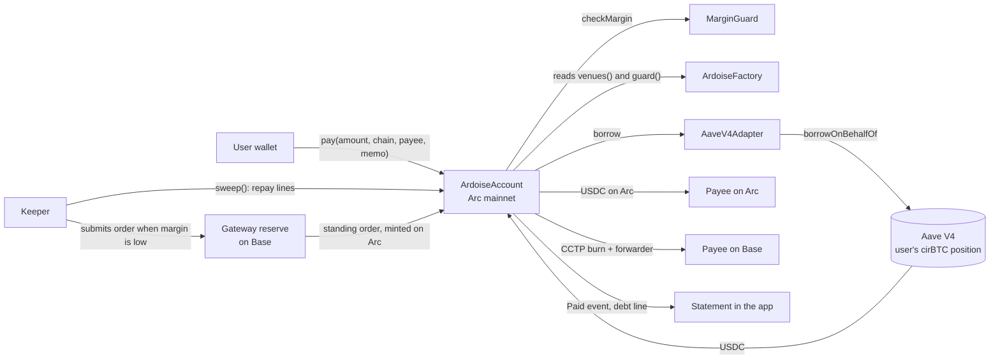

#  Ardoise

> Pay anyone, on any chain, with your bitcoin without selling it: each payment borrows exactly the amount on Arc at the best available rate, and your position is protected from liquidation.

Built for **UBC Hackathon 2026 (University Blockchain Conference, UT Austin)**, tracks *DeFi & Onchain Apps* and *Best use of Arc*. Running on **Arc mainnet** with real cirBTC collateral on Aave V4.

## Demo

- Live app: **https://ardoise-rust.vercel.app**, on Arc mainnet. It opens on a demo account simulated in the browser, with live lending rates and Circle fee quotes from mainnet; with a wallet that holds cirBTC collateral on Aave V4 on Arc mainnet, **Connect wallet** activates a real account. Standing orders cannot be signed there, since the keeper's order intake only listens locally.
- Demo video: _coming soon_
- Try it locally in 2 minutes: see [Try it in 2 minutes](#try-it-in-2-minutes).


*The pay screen on the demo account: live rates from Arc mainnet, margin before and after the payment, the Circle fee quote, and the statement.*

A real payment made from the app on Arc mainnet (2026-11-18):

| Step | Transaction |
|------|-------------|
| `pay()`: 0.40 USDC to a payee on Base, 0.45523 USDC borrowed on Aave V4 (CCTP fee included), debt line #1 | [Arc explorer](https://explorer.arc.io/tx/0x9dfdd3d8ba60968a8feaed312edd03ad8c238850e89ec3af05cb3aa8b5836aed) |
| USDC minted to the payee on Base by Circle's forwarder, 4 seconds later (block timestamps) | [Basescan](https://basescan.org/tx/0x80d15046477b5332f3c55150b82dfeba38dbb97e15af9e70d792ffa266408a4b) |
| 0.10 USDC sent to the account, then `sweep()` by the keeper 3 blocks later repays it against line #1 | [transfer](https://explorer.arc.io/tx/0x578f203c3bdc3ea4b11c4d9c1862cd7b24627b28f00e71eb7e35d118c1402466), [sweep](https://explorer.arc.io/tx/0xe68ac63117e4ad5fee25fa63c8f7b70927dcdcca9b283f8201b2490247cf929a) |

## The problem

Paying with bitcoin usually means selling it, which loses the exposure and, in the US, triggers capital gains tax. Borrowing against it avoids both, but today it is a loan you manage by hand: pick a lender, watch your margin, repay before you get liquidated.

On Arc, Circle's [Borrow Kit](https://docs.arc.io/app-kit/borrow) lends USDC against cirBTC through a single lender, Morpho, and leaves liquidation to Morpho. Yet the same collateral can borrow cheaper elsewhere: on 2026-11-17, the base USDC borrow rate against cirBTC was 3.10% a year on Aave V4 and 4.04% on Morpho, both on Arc mainnet (Aave adds a per-user risk premium on top of its base rate).

## The solution

Ardoise turns a cirBTC position on Arc into a payment account:

- **Pay from your bitcoin.** Enter an amount, a payee and their chain (Arc or Base). Ardoise borrows exactly that amount, plus the cross-chain fee, at the cheapest lending venue, and delivers it. Your bitcoin is never sold and never leaves your own Aave position.
- **See the rates and your margin before you pay.** The pay screen compares the live USDC borrow rates of Aave V4 and Morpho on Arc and shows how much margin the position keeps before and after the payment.
- **One line per payment.** The statement lists every payment as a debt line: amount, venue, rate, payee, memo and interest so far, built from the account's on-chain events. Each cross-chain payment has a tracking page that follows it until it lands on the payee's chain.
- **Protected from liquidation.** A position guard refuses any payment that would push the margin below a minimum. A keeper repays debt with the USDC sent to the account. From the Protection panel, the owner can also keep a USDC reserve in Circle Gateway on Base and sign standing orders that the keeper uses to repay when the margin gets too low, or repay from Base in one click (tested end to end on testnet; the mainnet test is pending).

Without a wallet, anyone can try the whole flow on a demo account simulated in the browser, with live rates from Arc mainnet and real Circle fee quotes. Connecting a wallet on Arc mainnet activates a real account.

**What Ardoise adds to Borrow Kit:**

| | Borrow Kit | Ardoise |
|--|-----------|---------|
| Lenders | Morpho only | Best rate across the venues of the factory; Aave V4 today, Morpho compared but not yet borrowed from |
| When you borrow | One loan, by hand | Exactly the amount of each payment, at payment time |
| Where the money goes | Your wallet on Arc | The payee, on Arc or on another chain through CCTP |
| Liquidation | Warning, then Morpho liquidates | Guard refuses risky payments; keeper repays from the account, or from a Gateway reserve on Base (mainnet test pending) |
| Record | Loan balance | One debt line per payment, with payee and memo |

## How it works



1. **One-time setup.** The user already has cirBTC supplied as collateral on Aave V4, in their own position (done on Aave). When they activate Ardoise, the app has them authorize Aave's position managers, create their `ArdoiseAccount` through the factory and give the adapter a capped borrow allowance ([`app/src/lib/setup.ts`](app/src/lib/setup.ts)).
2. **Pay.** `pay()` checks the account's caps, reads the factory's venues and picks the one with the lowest rate (`bestVenue`), asks the guard whether the margin stays above the minimum, borrows `amount + maxFee` on the user's behalf, then either transfers USDC on Arc or burns it with CCTP so that Circle's forwarder mints it to the payee on the other chain. It records a debt line and emits `Paid` ([`contracts/src/ArdoiseAccount.sol`](contracts/src/ArdoiseAccount.sol)).
3. **Protect.** `MarginGuard` refuses payments that would leave the health factor under 1.25 ([`contracts/src/guard/MarginGuard.sol`](contracts/src/guard/MarginGuard.sol)). The keeper, an off-chain Node process, watches every account and calls the public `sweep()` to apply the USDC on an account to its debt, oldest line first. When a position is under the minimum and the account holds nothing, it submits one of the owner's Gateway standing orders to bring USDC from Base ([`keeper/src/keeper.ts`](keeper/src/keeper.ts), [`keeper/src/gateway.ts`](keeper/src/gateway.ts)).

The collateral never moves to Ardoise: the account can only borrow within the allowance the user granted and repay; it cannot withdraw cirBTC. The full payment sequence, the interfaces and their invariants are in [`docs/api.md`](docs/api.md).

## Built with Circle and Arc

- **Arc mainnet:** the contracts are deployed on Arc mainnet (see [Deployed contracts](#deployed-contracts)) and every payment borrows on Arc's Aave V4 market. Gas on Arc is paid in USDC, so the user needs no other token. The app quotes, simulates and sends `pay()` and reads the statement from the account's logs ([`app/src/lib/chainArdoise.ts`](app/src/lib/chainArdoise.ts)), and the browser wallet signs on Arc ([`app/src/lib/wallet.ts`](app/src/lib/wallet.ts)). `NEXT_PUBLIC_ARDOISE_NETWORK` chooses Arc mainnet or Arc Testnet ([`app/src/lib/network.ts`](app/src/lib/network.ts)); the live USDC borrow rates of Aave V4 (through the deployed adapter) and Morpho are read on Arc mainnet ([`app/src/lib/venues.ts`](app/src/lib/venues.ts)).
- **USDC and cirBTC:** USDC is what each payment borrows and delivers; cirBTC, Circle's wrapped bitcoin on Arc, is the collateral in the user's Aave V4 position ([`contracts/src/venues/AaveV4Adapter.sol`](contracts/src/venues/AaveV4Adapter.sol)).
- **CCTP (Cross-Chain Transfer Protocol):** a payment to a payee on Base is burned on Arc with `depositForBurnWithHook` and minted on Base by Circle's forwarder ([`contracts/src/ArdoiseAccount.sol`](contracts/src/ArdoiseAccount.sol), [`contracts/src/cctp/ITokenMessengerV2.sol`](contracts/src/cctp/ITokenMessengerV2.sol)). The app tracks each delivery through Circle's attestation service (Iris): [`app/src/lib/delivery.ts`](app/src/lib/delivery.ts), shown on the payment page [`app/src/app/payments/[txHash]/page.tsx`](app/src/app/payments/[txHash]/page.tsx).
- **CCTP fees:** before each payment to Base, the app asks Iris for the transfer and forwarder fee and borrows it on top of the amount (`maxFee` in `pay()`): [`app/src/lib/fees.ts`](app/src/lib/fees.ts).
- **Gateway:** the keeper repays debt from the user's Circle Gateway balance on Base through standing orders, signed burn intents that can only pay the user's own Ardoise account, delivered on Arc by Circle's forwarder: [`keeper/src/gateway.ts`](keeper/src/gateway.ts). Users deposit, sign orders and repay in one click from the app ([`app/src/lib/gateway.ts`](app/src/lib/gateway.ts), [`app/src/components/ProtectionPanel.tsx`](app/src/components/ProtectionPanel.tsx)), and the keeper checks each order before storing it ([`keeper/src/intake.ts`](keeper/src/intake.ts)); explained in [`docs/api.md`](docs/api.md#gateway-standing-orders-b4). The keeper side was tested end to end on testnet; the mainnet test is pending.

## Economic design and risk assumptions

**Who pays what.** Ardoise charges no fee of its own. The user pays:

- **Interest** at the venue's variable USDC borrow rate (3.10% a year on Aave V4 when the contracts were deployed), on the amount borrowed, until it is repaid.
- **The cross-chain fee** for payments outside Arc, quoted by Circle and borrowed on top of the amount. For example, 0.05523 USDC to deliver 0.40 USDC on Base, almost all of it the forwarder fee, which is flat: it weighs less on larger payments. Payments on Arc have no such fee.
- **Gas on Arc**, in USDC, for their own transactions. The keeper's `sweep()` gas is paid by the keeper's wallet.
- **Gateway fees** when a standing order is used: about 0.025 USDC quoted for a 5 USDC order from Base to Arc.

**Limits built into the contracts:**

- **Caps per account:** 10 USDC per payment and 20 USDC per UTC day by default (set on the factory), applied to the amount plus the fee. They keep the demo exposure small.
- **Guard thresholds:** a payment is refused if it would leave the health factor under **1.25** (Aave liquidates under 1.0); the keeper repays towards **1.5**.
- **Borrow allowance:** the user grants the adapter a finite allowance on Aave V4 (60 USDC for the demo account), never an unlimited one, since the adapter is shared by every account.

**Risks we assume:**

- **Market and oracle.** The guard reads Aave's own health factor and oracle. A bitcoin drop faster than the keeper can react, or a reserve that is too small, can still lead to liquidation by Aave: Ardoise lowers the risk, it does not remove it.
- **Keeper liveness.** The keeper is a single off-chain process run by the team. If it stops, positions are not repaid automatically; `sweep()` is public, so anyone can run one.
- **Gateway timing.** Gateway credits a deposit on Base only after Base finality (8 minutes to about 1.5 hours observed on testnet), so a fresh reserve cannot be used right away.
- **Variable rates.** Rates move with each block; the debt line stores the rate at payment time and its interest is an estimate. The venue's debt is what is actually owed.
- **Fees.** The whole `maxFee` is charged on CCTP payments even when Circle's actual fee is lower, so the app quotes it tightly from Iris.
- **Trusted admin.** The factory admin chooses the venues and the guard every account uses. It is the team's dedicated project wallet.
- **Demo simulation.** For the demo, the guard's owner can simulate a bitcoin drop. It only makes Ardoise stricter (payments refused, keeper repays earlier), never touches Aave or anyone's real position, and must be set back to 0 after the demo (the demo itself is still to be recorded; [details](docs/api.md#price-drop-simulation-demo-only)).
- **Not audited.** The contracts were written during the hackathon week and have 131 Foundry tests, but no audit. Use small amounts only.

## Deployed contracts

On **Arc mainnet** (chain id 5042); the factory, adapter and guard sources are verified on Sourcify. Full deployment record, constructor arguments and checks: [`contracts/deployments.md`](contracts/deployments.md).

| Contract | Address |
|----------|---------|
| `ArdoiseFactory` | [`0xb44DD865DdD6a67b79C632Fe9795DB8e713692bD`](https://explorer.arc.io/address/0xb44DD865DdD6a67b79C632Fe9795DB8e713692bD) |
| `AaveV4Adapter` (USDC on the Aave V4 Main Spoke) | [`0x38B564d0b3d57216A34d83FbF08DE48744567b38`](https://explorer.arc.io/address/0x38B564d0b3d57216A34d83FbF08DE48744567b38) |
| `MarginGuard` (minimum health factor 1.25, target 1.5) | [`0xEBAC5C07DC0983C01f55AbEAD77a3FcC7a4cf080`](https://explorer.arc.io/address/0xEBAC5C07DC0983C01f55AbEAD77a3FcC7a4cf080) |
| Demo `ArdoiseAccount` | [`0xdcB201E7dFCB1edaacB53043ca12558A260B2bBD`](https://explorer.arc.io/address/0xdcB201E7dFCB1edaacB53043ca12558A260B2bBD) |

## Getting started

### Try it in 2 minutes

The fastest way is the [live app](https://ardoise-rust.vercel.app), with nothing to install. To run it locally instead:

Needs Node.js 22.9 or later. No wallet and no `.env` file are required: the app opens on a demo account simulated in the browser, with live lending rates from Arc mainnet. Without `.env` the app runs in testnet mode, so payments go to Base Sepolia or Arc Testnet and the cross-chain fee is quoted by Circle's sandbox.

```bash
git clone https://github.com/enzoblain/Ardoise.git
cd Ardoise/app && npm install && npm run dev
```

Open http://localhost:3000, enter an amount and a payee address, compare the rates, watch the margin gauge and click **Pay**: the payment appears as a new line in the statement.

### Prerequisites

- Node.js 22.9 or later, with npm
- [Foundry](https://book.getfoundry.sh/getting-started/installation) (`forge`), for the contracts only

### Installation

```bash
git clone --recurse-submodules https://github.com/enzoblain/Ardoise.git
cd Ardoise
(cd app && npm install)
(cd keeper && npm install)
cp .env.example .env   # optional for read-only use: Arc reads default to the public RPC
```

The app and the keeper both read the `.env` file at the repository root; every variable is described in [`.env.example`](.env.example).

### Run

Run the front end and the keeper in two separate terminals, from the repository root:

```bash
(cd app && npm run dev)      # front end on http://localhost:3000
```

By default the app runs on Arc Testnet with a simulated demo account. To use the deployed contracts, set `NEXT_PUBLIC_ARDOISE_NETWORK=mainnet` in the root `.env`, open the app with a browser wallet that holds cirBTC collateral on Aave V4, click **Connect wallet** and follow the one-time activation (Aave position managers, account creation, borrow allowance).

```bash
(cd keeper && npm start)     # keeper, polls Arc mainnet for new blocks
```

To let users sign Gateway standing orders from the app's Protection panel, set `GATEWAY_ORDERS_FILE` and `GATEWAY_INTAKE_PORT` (for example `8787`) for the keeper and `NEXT_PUBLIC_KEEPER_URL=http://localhost:8787` for the app. The intake listens on `127.0.0.1` only, so the app must run in a browser on the keeper's machine.

Foundry only reads a `.env` inside `contracts/`, so export the root one before using an RPC alias (`--rpc-url arc`):

```bash
set -a && source .env && set +a
```

### Test

```bash
(cd contracts && forge build && forge test)
(cd app && npm run lint && npm test && npm run build)
(cd keeper && npm run typecheck)
```

## Project structure

```
contracts/   Solidity contracts (Foundry): account, factory, Aave V4 adapter, margin guard, deployment scripts and records (deployments.md)
app/         Next.js + viem front end: pay screen, rate comparison, margin gauge, statement, Protection panel, payment tracking page
keeper/      Node keeper: repays debt with sweep() and Gateway standing orders, and receives standing orders from the app
docs/        Contract interfaces and payment flow (api.md), hackathon roadmap (roadmap.md), README screenshot (images/)
assets/logo/ Logo files (SVG: mark, full logo, wordmark, app icon, favicon, white and black versions) and brand-showcase.html, the brand reference page
```

## Roadmap

What would come after the hackathon:

- **Borrow on Morpho**, not only compare it: a Morpho adapter, so `bestVenue` picks between two real lenders, and EURC borrowing on Morpho's EURC/cirBTC market.
- **Refinance between venues** when another lender becomes cheaper.
- **A hosted keeper intake**, so standing orders can be signed from a deployed app, and several independent keepers.
- **Passkey wallets** (Circle Modular Wallets) once they are available on Arc mainnet.
- **Per-user guard settings and a real price-drop alert**, instead of the shared thresholds.
- **An audit**, then higher caps.

## Team

- **Enzo Blain**: product, front end, Circle integration (CCTP, Gateway), demo
- **Hugo Thomas**: contracts, lending venues, position guard, keeper

## License

MIT, see [`LICENSE`](LICENSE).
