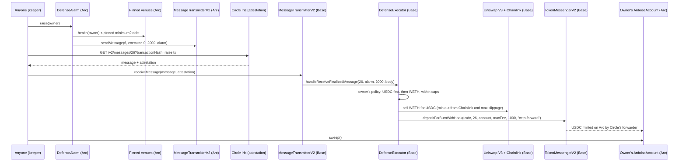

# Contract interfaces

The interfaces below are the single contact point between the tracks (see [`roadmap.md`](roadmap.md), task 0.4). They are frozen: changing one means telling the others first. The NatSpec in each file is the reference; this page explains how they fit together.

| Interface | File | Implemented by | Used by |
|-----------|------|----------------|---------|
| `IVenue` | [`contracts/src/interfaces/IVenue.sol`](../contracts/src/interfaces/IVenue.sol) | `AaveV4Adapter` (A1), `MorphoAdapter` (R5) | `ArdoiseAccount`, guard, app (rate comparison, margin gauge) |
| `IArdoise` and `DebtLine` | [`contracts/src/interfaces/IArdoise.sol`](../contracts/src/interfaces/IArdoise.sol) | `ArdoiseAccount` (A2, A3) | app (pay screen, statement), keeper |
| `IArdoiseFactory` | [`contracts/src/interfaces/IArdoiseFactory.sol`](../contracts/src/interfaces/IArdoiseFactory.sol) | factory (A2) | venue adapters (caller check), app and keeper (finding a user's account) |
| `IGuard` | [`contracts/src/interfaces/IGuard.sol`](../contracts/src/interfaces/IGuard.sol) | `MarginGuard` (B1, B3) | `ArdoiseAccount.pay()` and `payVia()`, app, keeper |

## Units

| Quantity | Unit |
|----------|------|
| Token amounts | Token decimals (USDC: 6, cirBTC: 8) |
| Borrow rates | Yearly rate in basis points (1 bps = 0.01%) |
| Health factors | WAD (1e18 = 1.0, liquidation below 1.0); `type(uint256).max` without debt |
| USD values | WAD (1e18 = 1 USD) |
| Payees | `bytes32`, left-padded EVM address, as CCTP expects |
| Chains | CCTP domain ids (Arc = 26, Base = 6) |

## Who owns what

- **The collateral stays in the user's wallet.** The cirBTC position on Aave V4 belongs to the user's address, not to Ardoise. On Aave V4, Ardoise can only borrow within the allowance the user granted and repay; it can never withdraw collateral. On Morpho (R5), the authorization a user grants also allows withdrawals, so that guarantee holds for Aave V4 only.
- **One `ArdoiseAccount` per user**, created by `IArdoiseFactory.createAccount()`. The app and the keeper find it with `accountOf(user)` or the `AccountCreated` event. It holds the debt lines, the caps and any USDC waiting to repay debt; the owner, and nobody else, can take that USDC back with `withdraw(amount)` (see [Implementation notes](#implementation-notes-ardoiseaccount-ardoisefactory); accounts of the current factory only, not those of the earlier factories). A plain USDC `transfer()` to the account runs no code, so `sweep()` lets anyone (the keeper included) apply that balance to the debt. `sweep()` is implemented in A2 (Track A); the keeper (B2) depends on it.
- **The factory holds the venue list and the guard** that every account reads, so they can be redeployed without new accounts. Deployment order: factory, then adapters and guard (pointing to the factory), then `setVenues` and `setGuard`. A venue the admin adds later reaches an account only once its owner accepts it (see *Accepted venues* under *Implementation notes*).
- **Venue adapters are shared.** An adapter only accepts `borrow` calls from `factory.accountOf(user)` and sends the tokens to the caller. It must never trust `IArdoise(msg.sender).owner()`: any contract can claim a victim as its owner.
- **Debt lines are USDC only** and their `accruedInterest` is an estimate; the venue's `debtOf` is what is actually owed. Borrowing EURC (R5) would need a new line format.
- **The price-drop simulator (B3)** is outside these interfaces: it lives in `MarginGuard` as an owner-only simulated drop, described in [Price-drop simulation](#price-drop-simulation-demo-only). The demo labels it as a simulation, and `checkMargin` reads the real oracle whenever the drop is 0.

## Payment flow

```mermaid
sequenceDiagram
    participant U as User wallet (passkey)
    participant A as ArdoiseAccount
    participant G as Guard
    participant V as Venue adapter
    participant L as Aave V4 (Taker position manager)
    participant C as CCTP + forwarder
    U->>A: payVia(venue, amount, domain, payee, maxFee, memo) or pay(...)
    A->>A: check caps; venue = the one chosen, or bestVenue(amount + maxFee)
    A->>G: checkMargin(user, venue, amount + maxFee)
    G-->>A: allowed
    A->>V: borrow(user, amount + maxFee)
    V->>V: check factory.accountOf(user) == caller
    V->>L: borrowOnBehalfOf(spoke, 0, amount + maxFee, user)
    L-->>V: USDC
    V-->>A: USDC
    alt destination is Arc
        A->>A: USDC transfer to the payee on Arc
    else other chain
        A->>C: depositForBurnWithHook (forwarder mints on the payee's chain)
    end
    A->>A: record DebtLine, emit Paid
```

## Implementation notes (`ArdoiseAccount`, `ArdoiseFactory`)

Behaviour the frozen interfaces leave open, as implemented in [`ArdoiseAccount.sol`](../contracts/src/ArdoiseAccount.sol) and [`ArdoiseFactory.sol`](../contracts/src/ArdoiseFactory.sol), checked on Arc mainnet (see the A2 row in [`roadmap.md`](roadmap.md)).

- **Line ids start at 1** and follow payment order; `lines()` returns them oldest first.
- **CCTP:** payments to another chain call `depositForBurnWithHook(amount + maxFee, domain, payee, USDC, bytes32(0), maxFee, 2000, "cctp-forward")` on the TokenMessengerV2 `0x28b5a0e9C621a5BadaA536219b3a228C8168cf5d`. 2000 (standard finality) is what Circle documents for Arc as a source: attested in about 0.5 s, with no separate fast transfer. On mainnet, an Arc → Base payment was minted on Base 6 s after the Arc block.
- **The whole `maxFee` is charged.** On mainnet, a payment with `maxFee` 0.06 USDC delivered exactly `amount` on Base (`feeExecuted` = 0.06) while Circle quoted about 0.054. Despite the `Paid` NatSpec, the unused part of `maxFee` does not reach the payee with the Forwarding Service: the app should set `maxFee` to the `forwardFee.high` quoted by `GET https://iris-api.circle.com/v2/burn/USDC/fees/26/<domain>?forward=true`, plus the protocol fee, rounded up.
- **Payees:** every domain needs a left-padded EVM address except the known non-EVM CCTP domains (Noble 4, Solana 5, Sui 8, Aptos 9), which accept all 32 bytes.
- **Errors beyond the interface:** `ZeroAmount`, `FeeOnArc(maxFee)` (a payment on Arc must pass `maxFee` 0), `BorrowShortfall(expected, received)`, `GuardNotSet`, `Reentrancy`, `TokenCallFailed`, and `VenueAlreadyAccepted(venue)`, `VenueNotAccepted(venue)`, `TooManyVenues` for the accepted venues, `InsufficientBalance(requested, balance)` (a withdrawal above the account's USDC balance), on the account; `NotAdmin(caller)`, `InvalidVenue(venue)` (the venue does not lend the factory's USDC or does not trust this factory) and `ZeroAddress` on the factory.
- **Caps** apply to `amount + maxFee`; the UTC day is `block.timestamp / 1 days`. New accounts get the factory's `defaultPerPaymentCap` and `defaultDailyCap`.
- **Accepted venues:** the account borrows from, approves and pays only venues that are both in the factory's list and in its own accepted set; `venues()` returns exactly those, each once, in the factory's order. An adapter is trusted with the USDC on the account (`sweep()` approves it for the debt it reports), so the admin listing a venue is not enough: without the owner's consent, a venue that reports a false debt, or quotes a rate of 0 to be chosen by `pay()`, gets nothing. The accepted set starts as the factory's list when the account is created (duplicates once, at most `MAX_ACCEPTED_VENUES` = 8), with one `VenueAccepted(venue)` event each: read `factory.venues()` before `createAccount()`, since creating the account accepts that list. The snapshot trusts the factory's list as it stands in the creation transaction, and the admin can change it just before: read `acceptedVenues()` right after creating the account and `revokeVenue` anything unexpected before sending USDC to the account, granting a borrow allowance or authorizing an adapter. The app does: once the account exists, in setup and on the live account, it compares `acceptedVenues()` with the deployment's adapters, holds back the borrow allowance (and, on the live account, the pay screen) while an unexpected venue is accepted, offers to `revokeVenue` it, and says when an adapter is missing ([`app/src/lib/venueCheck.ts`](../app/src/lib/venueCheck.ts), [`app/src/components/VenueCheck.tsx`](../app/src/components/VenueCheck.tsx)). A passkey account activates in one user operation that creates the account and grants the allowance together, so for it the check only applies to later renewals. Afterwards only the owner changes it, with `acceptVenue(venue)` (the venue must be in the factory's list; reverts with `UnknownVenue`, `VenueAlreadyAccepted` or `TooManyVenues`) and `revokeVenue(venue)` (`VenueRevoked(venue)`; reverts with `VenueNotAccepted`); `acceptedVenues()` returns the set, listed by the factory or not. A venue the admin delists leaves `venues()` but stays accepted, with no event on the account, and is usable again the moment it is relisted: `revokeVenue` a delisted venue you no longer want. `IArdoise.venues()` says "read from the factory"; the implementation returns the factory's list restricted to the accepted set. None of the three functions is part of `IArdoise`. The keeper and the defense alarm keep reading the factory's list: `sweep()` simply does nothing for a venue the owner did not accept, and the app's pay screen offers the deployed adapters, so a payment on a venue the owner has not accepted fails its simulation with `UnknownVenue` (the app has no screen for `acceptVenue` yet). Accepted venues are deployed since 2026-11-19 on the accounts of the current factory; accounts of the earlier factories do not have them (see [`contracts/deployments.md`](../contracts/deployments.md)).
- **Venue choice:** `bestVenue` considers only `venues()`, the listed venues the owner accepted. It skips venues whose `available()` or `rate()` reverts or whose liquidity is short, then asks the guard in order of rate and takes the first venue where it allows the full amount; ties go to the first venue in the factory's list. A cheaper venue where the owner has no position therefore never blocks a payment another venue can make. When the guard allows the full amount nowhere, the venue allowing the most is returned and `pay()` reverts with `PaymentRefused` and that amount. `bestVenue` is a recommendation: the app badges it and selects it by default, and the owner may pick another venue with `payVia(venue, …)`, which runs the same caps, the guard check on that venue, the same debt line and `Paid` event, with no fallback. `payVia` reverts with `UnknownVenue(venue)` for a venue outside the factory's list or one the owner did not accept, with `NoVenueAvailable` when that venue's `available()` is short, and with `PaymentRefused` when the guard allows less there; `pay()` is `payVia(bestVenue(amount + maxFee), …)`. With more than one borrowable venue the app always calls `payVia` with the venue on screen, so the payment borrows exactly where the user saw it ([`app/src/lib/chainArdoise.ts`](../app/src/lib/chainArdoise.ts)). The factory deployed with the Morpho venue (R5, see [`contracts/deployments.md`](../contracts/deployments.md)) runs this version; the first factory (A4) took the cheapest venue before asking the guard.
- **Interest estimate:** simple interest at `rateBps` on the principal since `openedAt`, rounded down. `rateBps` is the venue's `rate()` in the payment, capped at `MAX_LINE_RATE_BPS` (10,000 bps, 100% a year): the venues quote a few percent, and on a usable venue `sweep()` repays the real debt whatever the estimate says, so the cap only limits what a line can claim. A line closes when its repayments cover principal plus estimate, or when the owner's debt on its venue reaches 0. A closed line's `accruedInterest` is what was repaid beyond the principal.
- **Repayment:** `repay` pulls at most what the line owes by its estimate and refunds what the venue does not take; the line is credited with what the venue took if that is more than the debt it reports as restored.
- **`sweep()`** serves `venues()`, the listed venues the owner accepted, and never reads, approves or pays any other venue, whatever debt and health it reports. It serves them in order of the owner's health factor, lowest first (ties keep the factory's order, a venue whose `health()` reverts goes last), so the balance goes to the position closest to liquidation: Aave V4 and Morpho are separate positions, and repaying the healthy one would leave the other in danger. On each venue it repays the open lines oldest first, then the owner's remaining debt there (venues compound a variable rate while line estimates use simple interest, and the owner may have debt opened outside Ardoise); open lines on a venue the factory no longer lists or the owner revoked come last, never the venue's whole reported debt (a line can only have been opened on a venue the owner had accepted). **Bound on a line:** every repayment, through `repay` or `sweep()`, credits the line with the larger of the debt the venue says it restored and the USDC it actually took, and that amount is what `LineRepaid` and the return value carry. The USDC paid through a line therefore never exceeds its estimate at the time of the payment, principal plus simple interest at the rate recorded when it was opened, whatever the venue reports and however often `sweep()` is called; this is all a revoked or delisted venue can receive. The estimate is not a fixed amount: interest keeps running while the line is open, and a hostile venue can keep its line open (by taking slightly less than what is owed, or nothing). The recorded rate is the one the venue quoted in the payment, capped at `MAX_LINE_RATE_BPS` = 10,000 bps (100% a year), so such a venue collects at most its principal once, plus at most that principal again per year the line stays open: about 0.27% of the principal per day, 0.07% in six hours. Without the cap a venue could record up to `type(uint32).max` bps, about 49 times the principal per hour. With an honest adapter both amounts are equal, so nothing changes. **What a venue cannot do to a sweep:** a venue is skipped, and the others are still served in the same sweep, when its `repay`, `debtOf` or `health` reverts or returns missing or malformed data, when it reports more than it was approved for (the report is capped at the approval) and when it sends USDC to the account during `repay` (counted as nothing spent); only the first 32 bytes it returns are read. This holds for every venue in the sweep, usable or not. What remains is gas: the calls forward the gas the sweep has, so a venue with an open line that burns all of it makes each `sweep()` fail for as long as that line is open, and the owner has no way to abandon a line yet; `repay(lineId, …)` on the other lines still works. `repay` by an external payer still reverts with the venue's own error. Anything left after the sweep stays in the account, where the owner can withdraw it (see *Withdrawal* below). Its return value adds the amount applied to each line and, for the debt repaid beyond the lines on a usable venue, what that venue reports (at most what it was approved for). That second pass credits no line, so a closed line can show less interest than the venue actually charged, and a line skipped earlier in the same sweep only shows as closed after the next `sweep()` or `repay(lineId, 0)`. A line whose venue keeps refusing is retried, at a gas cost, on every sweep. It does not read the guard, so it keeps working while the factory has none.
- **Closed lines:** `DebtLine` has no closed flag, and a line closed because its venue debt reached 0 can show `repaid` below `principal`. The account exposes `closed(lineId)` (not part of `IArdoise`) for the statement.
- **Withdrawal:** `withdraw(amount)` (not part of `IArdoise`, like `closed`) sends `amount` of the account's idle USDC to the owner and emits `Withdrawn(to, amount)`, with `to` always the owner. Owner only (`NotOwner`), non-reentrant; it reverts with `ZeroAmount` for 0 and with `InsufficientBalance(requested, balance)` above the balance. It is the way out for USDC that `sweep()` cannot apply: more USDC than debt (a Gateway standing order or a defense larger than the debt, a transfer by mistake), or a venue that refuses repayments, in which case the owner can then repay that venue directly. It reads neither the guard nor the venues, so it works without a guard and whatever the venues do. It does not get around the guard or the caps: `pay()` transfers or burns the whole `amount + maxFee` it borrowed in the same transaction, so nothing a payment borrows is left to withdraw. The exception is what a venue sends beyond the amount asked, which stays on the account, is owed by the owner and was counted by neither check; both adapters send exactly what is asked. USDC withdrawn before a `sweep()` no longer repays the debt: that is the owner's choice, on the owner's own position. There is no "everything" value (`type(uint256).max` reverts like any amount above the balance): the app reads the account's USDC balance. Deployed on the accounts of the current factory (see [`contracts/deployments.md`](../contracts/deployments.md)); accounts of the earlier factories do not have it. The app's Withdraw panel ([`app/src/components/WithdrawPanel.tsx`](../app/src/components/WithdrawPanel.tsx), [`app/src/lib/withdraw.ts`](../app/src/lib/withdraw.ts)) shows that balance and calls `withdraw(amount)` from the owner's browser wallet or passkey smart account.
- **Trust:** the factory admin is trusted for the guard, and for the venue list accounts accept when they are created. Accounts pay only if the admin's guard agrees, and borrow from, and approve repayments to, the venues their owner accepted among those the admin lists: the admin can remove a venue from every account by delisting it, but cannot add one to an existing account. An accepted adapter stays trusted with the USDC on the account, and the admin can still stop payments by replacing the guard.
- **Without a guard** (for example after `setGuard(0)`), `pay()` and `payVia()` revert with `GuardNotSet()`; repayments, `sweep()` and `withdraw()` still work.

## Price-drop simulation (demo only)

`MarginGuard` ([`contracts/src/guard/MarginGuard.sol`](../contracts/src/guard/MarginGuard.sol)) can reason as if the collateral price had dropped, so that the demo can show a payment being refused and a repayment restoring the margin without waiting for the market. These members are additions of the implementation, not part of the frozen `IGuard`:

| Member | Use |
|--------|-----|
| `simulatedDropBps()` | Simulated drop in basis points; `0` means the simulation is off (the normal state). The app shows a "SIMULATION — BTC -x%" banner whenever it is not 0 |
| `simulatedHealth(venue, user)` | Health factor as the guard sees it (WAD, `type(uint256).max` without debt): the venue's health factor scaled by `(10_000 - simulatedDropBps) / 10_000`. The margin gauge reads this instead of `venue.health(user)` |
| `setSimulatedDrop(dropBps)` | Owner only, at most `MAX_SIMULATED_DROP_BPS` (`9_000`, 90%). Emits `SimulationUpdated(dropBps)`; reverts with `NotOwner(caller)` or `InvalidSimulatedDrop(dropBps)` |

- **What it changes:** Ardoise's own decisions, and through them real funds. `checkMargin` refuses or reduces payments as if the price had dropped. The keeper judges positions with the same simulated health factor, so it sweeps and submits Gateway standing orders earlier than the real price requires: real USDC from the owner's reserve repays real debt. A `DefenseAlarm` deployed with `honorsSimulation = true` also raises alarms on it, and its executor then sells the owner's pre-authorized WETH on Base (see [CCTP-attested defense](#cctp-attested-defense-d1)).
- **What it never changes:** Aave, its oracle and what `venue.health(user)` returns. Nobody can be liquidated because of the simulation. A production `DefenseAlarm` (`honorsSimulation = false`) never reads it.
- **It is global:** the guard is shared by every account of the factory, so a non-zero drop refuses or reduces payments for every user, not only the demo one, until the owner sets it back to 0. It can only make the guard stricter: it never lets through a payment the real guard would refuse. It is not harmless for other users, though: while it is on, the keeper repays early for every account, and anyone can raise an alarm on a simulation-honoring `DefenseAlarm` for every owner holding a policy on its executor. After a demo, check that `simulatedDropBps()` is 0.
- **Why scaling the health factor is right:** it is risk-adjusted collateral over debt, so with cirBTC as the only collateral a price drop of x% multiplies it by (1 - x%), up to rounding dust. With several collateral assets the simulation means "every collateral -x%", which is stricter than a drop of BTC alone.
- **Gauge and payments:** `simulatedHealth` derives from `venue.health`, `checkMargin` from `venue.healthAfter`; they may differ by a few wei, so a gauge exactly at the minimum does not guarantee that a payment passes.
- **Outside the demo** the drop stays at 0 and `checkMargin` reads the real oracle through the venue, at the same gas cost as without the feature.

## Gateway standing orders (B4)

A user who keeps USDC in Circle Gateway on Base can let the keeper repay their debt from it when a position falls under the guard's minimum and the account holds nothing to repay with.

- **Standing order:** a Gateway burn intent the owner signs in advance (EIP-712, domain `GatewayWallet` version `1`): a fixed `value` of their Gateway balance on Base (domain 6), delivered on Arc (domain 26) to **their own Ardoise account**, with `destinationCaller` zero so that Circle's forwarder can mint, and no hook data. Gateway accepts a `maxBlockHeight` up to about 70 days ahead on Base, so orders are renewed every few weeks.
- **Keeper:** reads orders from `GATEWAY_ORDERS_FILE` (a JSON array of `{ burnIntent, signature, contractSigner? }` with addresses as left-padded bytes32; a malformed entry is skipped). For `decide()`'s shortfall it submits the smallest unused order that covers it, or else the fewest, to `POST /v1/transfer?enableForwarder=true`, follows each transfer, and sweeps the USDC into the debt on a later pass. The shortfall of a venue is capped at `venue.debtOf(owner)` and reduced by the USDC already on the account, as `DefenseAlarm.shortfall` does. An order has a fixed amount and USDC beyond the debt would stay on the account (accounts of earlier factories have no withdrawal; on the current one the owner would have to withdraw it by hand), so the keeper never submits orders that add up to more than the owner's debt on every venue less the USDC already on the account (`selectOrders`, `debtLeftToFund` in [`keeper/src/decision.ts`](../keeper/src/decision.ts)): an order larger than that is skipped with a log line, a smaller one is still used for a partial repayment, and when no order fits nothing is drawn from Gateway and the shortfall is left to the CCTP-attested defense below. When a venue's `debtOf` cannot be read on a pass, the keeper still sweeps and still runs the defense step, but draws nothing from Gateway, since the amount could not be capped. A balance under the 0.1 USDC sweep minimum is swept all the same when it is enough to bring a position under the minimum back to the target. A position under the minimum with no USDC debt on its venue is logged with a warning: the keeper cannot repay it. It refuses any order whose recipient is not the owner's account (the pair from the factory's `AccountCreated` event), whose depositor is not the owner, or that uses other contracts, tokens or domains (`rejectReason` in [`keeper/src/gateway.ts`](../keeper/src/gateway.ts)). An order Gateway refuses for another reason than a spent salt (balance not credited yet, server error, timeout) is retried with a growing delay. Without `KEEPER_PRIVATE_KEY` the keeper runs dry and submits no order either, although submitting needs no key.
- **From the app:** the Protection panel ([`app/src/components/ProtectionPanel.tsx`](../app/src/components/ProtectionPanel.tsx), [`app/src/lib/gateway.ts`](../app/src/lib/gateway.ts)) shows the Gateway balance on Base and deposits into it (approve + `GatewayWallet.deposit` on Base), has the wallet sign standing orders (signatures only, no gas) and posts them to the keeper, and offers a one-click repayment: one order submitted to Gateway right away, delivered on the account, then applied with `sweep()`.
- **Keeper intake:** `POST /orders` on `GATEWAY_INTAKE_PORT` stores an order only if its recipient is `factory.accountOf(depositor)`, it passes `rejectReason` (signer and depositor are the owner), and the signature is the depositor's, verified on Base (EOA or ERC-1271). Chain checks run before the write lock; at most 10 orders per request and 40 live orders per owner, checked before any chain read; expired and used orders are dropped. `GET /orders?owner=` lists live orders as summaries (value, expiry, salt) without signatures. It listens on `127.0.0.1` only, with CORS limited to `APP_ORIGIN`: a browser on the keeper's machine can reach it, a hosted app cannot as is. Chain or file failures are answered with a generic 503 so that no RPC URL leaks ([`keeper/src/intake.ts`](../keeper/src/intake.ts)).
- **Bearer orders:** a signed standing order can be submitted to Gateway by whoever holds it. It can only move the owner's reserve onto their own account, repaying their debt for Gateway's fee, which is why the intake never returns signatures. Standing orders are signed with twice Gateway's estimated fee cap, since they may be used weeks later; Gateway charges only the actual fee. The keeper remembers used orders in memory only: after a restart, orders spent before it are listed as live until the funder tries one and Gateway reports it spent.
- **Passkey owners:** Circle derives a passkey's smart account at the same address on Arc and on Base, so it is both the account owner and the Gateway depositor; the app checks the two addresses match and stops otherwise. It deposits on Base in one user operation (approve + deposit, plus its deployment the first time) and signs burn intents through ERC-1271; Gateway checks such a signature only when the request carries `contractSigner: true`, and only against a deployed account ([`app/src/lib/gatewaySigner.ts`](../app/src/lib/gatewaySigner.ts)). The intake sets that flag itself from the code at the depositor's address on Base (an EIP-7702 delegation still signs as an EOA) and refuses a smart account that is not deployed there yet.
- **Why it is safe:** an order can only pay the account it names, and that account can only repay its owner's debt (or, with `withdraw`, hand the USDC back to that same owner), so the keeper holds no key that can move user funds and a leaked order can do nothing but repay that debt or leave the USDC on the owner's account. Gateway checks the signature (ERC-1271 for smart contract wallets).
- **Cost:** on mainnet, Gateway quoted 0.0248 USDC for a 5 USDC order from Base to Arc (0.01 Gateway fee + 0.0148 forwarding).

## CCTP-attested defense (D1)

When a position stays under the minimum health factor after the sweep and the Gateway standing orders, the owner's funds on Base can repay the debt on Arc, but only on the strength of a message Circle attests: no keeper or relayer decides it, and the alarm pins what it trusts when it is deployed, so the factory admin and the guard owner cannot move its trigger afterwards.

> The alarm described here is deployed for the current factory in two pairs since 2026-11-19: production (alarm `0x71146B387B1dF474dd165d35b384A38E1a02813b`, executor `0xbb8c9935BFE2F15169E7195E212AB50134064E5B`, `honorsSimulation` false) and demo (alarm `0xFbd04d6263aDD461C523f34C8c3717Fb5c437545`, executor `0x7016D3D0a4DB22c6C2079C5e7172a1A4d2161f29`, `honorsSimulation` true: only demo wallets may set a policy on its executor). The earlier pairs (alarms `0x7147a1aE…B3B8`, `0x3BABC3f5…5E43` and `0xFD8d18C9…4dEC`) read the factory's venues and guard on every call and decide on the guard's simulated health factor: **anyone who sets a policy on their executors is exposed to every simulated drop on the shared guard.** The demo wallet cleared its policies there (see [`contracts/deployments.md`](../contracts/deployments.md#cctp-attested-defense-d1)).

| Contract | Chain | File |
|----------|-------|------|
| `DefenseAlarm` | Arc | [`contracts/src/defense/DefenseAlarm.sol`](../contracts/src/defense/DefenseAlarm.sol), ABI in [`IDefenseAlarm.sol`](../contracts/src/defense/interfaces/IDefenseAlarm.sol) |
| `DefenseExecutor` | Base | [`contracts/src/defense/DefenseExecutor.sol`](../contracts/src/defense/DefenseExecutor.sol) |
| Message body | both | [`contracts/src/defense/DefenseMessage.sol`](../contracts/src/defense/DefenseMessage.sol) |



**Message** (`DefenseMessage`): `abi.encode(address owner, address account, uint256 amountNeeded, uint64 nonce, uint64 expiry)`, 160 bytes, sent with `sendMessage(6, executor, bytes32(0), 2000, body)`; generic messages carry no CCTP fee.

**`DefenseAlarm` (Arc)** — the ABI the keeper (D2) relays from:
- `raise(owner) returns (uint64 nonce)`: permissionless. First calls the account's public `sweep()`, so USDC already on the account (an earlier defense, a Gateway repayment) is applied before measuring. Reads the account from the factory (`factory.accountOf`) and nothing else: the venues and the thresholds are the ones pinned at deployment. Uses the first pinned venue whose health factor is under the pinned `minHealthFactor()`. `amountNeeded = debtUsd x (target - health) / target` in USDC, rounded up and capped at `venue.debtOf(owner)`: health factors scale with 1 / debt at constant collateral, so this restores the pinned `targetHealthFactor()`. The venue's asset (USDC) still on the account after the sweep is then deducted: it repays the debt on the next `sweep()`, so Base is never asked for it, even when a caller starves a repayment nested in the sweep of gas. Reverts with `ExecutorNotSet`, `NoAccount`, `CoolingDown(nextAllowed)`, `PositionHealthy` or `SweepOutOfGas` (retry with more gas). A venue that reverts is skipped. **For the keeper:** a `PositionHealthy` revert after USDC reached the account means the sweep alone restores the position; it is rolled back with the revert, so call `sweep()` on the account directly. It can also mean that the alarm and the keeper disagree: the keeper judges positions on the guard's current thresholds and simulated drop, a production alarm on the real health factor and the thresholds it pinned.
- **Pinned at deployment, with no setter:**
  - `venues() returns (IVenue[])`: a copy of `factory.venues()` taken by the constructor (1 to `MAX_VENUES` = 8 contracts). A venue listed on the factory later is ignored, so a venue added by the factory admin cannot report a false health factor to the alarm.
  - `minHealthFactor()` and `targetHealthFactor()`: read once from `factory.guard()`, and required to satisfy `target > min > 1e18`. A later `setThresholds` on the guard or `setGuard` on the factory does not change them.
  - `honorsSimulation() returns (bool)`: the health source. `false` (production): the venue's own `health(owner)`; the guard is never called and `simulationGuard()` is zero, so a simulated drop cannot raise an alarm. `true` (demo pair only): `simulatedHealth(venue, owner)` of the guard pinned in `simulationGuard()` (the venue's own health factor if that read reverts). **A simulation-honoring alarm lets the guard owner, and anyone while a drop is on, trigger real spending on Base for every owner holding a policy on its executor, up to their caps. Pair it only with an executor reserved for demos, on which only demo wallets set a policy.**
  - The trade-off: a new venue, new thresholds or a new guard reach the defense only through a new alarm, and therefore a new executor (it trusts one alarm address) on which every owner sets a policy again.
- `event AlarmRaised(address indexed owner, address indexed account, uint256 amountNeeded, uint64 nonce, uint64 expiry)`; nonces count from 1 across all owners.
- `cooldown(owner) returns (uint64)`: timestamp from which `raise(owner)` is allowed again (0 or a past time: now). `shortfall(owner) returns (IVenue, uint256)` is the same computation as `raise`, as a view: `(0, 0)` when no venue is under the minimum, `(venue, 0)` when one is but the USDC on the account covers the need (a `sweep()` restores it). The idle USDC is credited to the first venue under the minimum while `sweep()` repays lines oldest first across venues, so with several venues that venue may get less until the next alarm. Once accounts have `withdraw` (not deployed), an owner who withdraws idle USDC that `shortfall()` had counted leaves the defense short by that amount until the next alarm: the alarm asked Base for less, and only the owner can cause it.
- Constructor: factory, MessageTransmitterV2, executor domain (6), cooldown (default 1800 s), alarm TTL (default 900 s), `honorsSimulation` (`false` for production). The constructor refuses a TTL longer than the cooldown (`InvalidTiming`), so two alarms for one owner are never executable at once, a factory without a guard (`GuardNotSet`), thresholds out of order (`InvalidThresholds(min, target)`) and an empty or oversized venue list or a venue without code (`InvalidVenues`). Funds still on their way back from Base are covered by the executor's `minDefenseInterval` (below). `setExecutor(address)` once, by the deployer, after the executor is deployed on Base.

**`DefenseExecutor` (Base)**:
- Acts only when `msg.sender` is the MessageTransmitterV2, `sourceDomain` is 26, `sender` is the alarm and `finalityThresholdExecuted >= 2000`; unfinalized messages always revert. Each alarm nonce is consumed once (`alarmUsed`).
- **Owner policy:** `setPolicy(assets, caps, period, maxSlippageBps, maxFee)` by the owner on Base (same address as on Arc), plus plain ERC-20 approvals to the executor. Assets are USDC or the swap assets fixed at deployment (WETH, ETH/USD feed, 0.05% pool); caps are per asset per `period`, in the asset's units; slippage is at most 10% and, for a policy that sells an asset, at least `minSlippageBps(asset)`, twice the fee of the asset's pool (10 bps for WETH on the 0.05% pool), else `setPolicy` reverts with `SlippageBelowPoolFee(asset, minSlippageBps)`: the pool fee comes out of the swap's output, so a lower bound fails on a pool exactly at the oracle price and, since a failed swap reverts the delivery, would leave the owner with no defense at all; the minimum only rules out bounds that cannot work, 50 to 100 bps remain the sensible setting; `maxFee` is the CCTP fee the owner accepts (Base → Arc fast: 0.325 bps protocol fee plus about 0.017 USDC forwarding, see `GET https://iris-api.circle.com/v2/burn/USDC/fees/6/26?forward=true`). Set `maxFee` with headroom over the quote so defenses stay on the fast path (seconds instead of 13–19 minutes); if it does not cover the forwarding fee, the burn is not minted automatically and must be relayed by hand, and a later defense may then repay more than needed (nothing is lost, the surplus repays debt through `sweep()`). `clearPolicy()` stops future defenses.
- **On an alarm:** gathers `amountNeeded + maxFee` USDC, in policy order, within caps, allowances and balances. WETH is sold with an exact-output swap when it can cover the rest (at most the Chainlink value plus the slippage bound) or an exact-input swap with a Chainlink minimum otherwise; a swap that fails reverts the whole delivery, so the message stays deliverable: with `SwapOutOfGas` when less than `MIN_SWAP_GAS` (300k, about three times a defense-size swap on the WETH/USDC pool) is left before the swap or the swap ran out of gas in its own frame, with `SwapFailed(asset)` otherwise, in practice when the pool price is outside the slippage bound against Chainlink. Anyone can relay, so a relayer could otherwise consume the alarm without a defense by sending too little gas or by pushing the pool away from the oracle in the delivery transaction. The USDC is burned with `depositForBurnWithHook(amount, 26, account, USDC, 0, maxFee, 1000, "cctp-forward")`: the only destination is the account named in the attested message, and Circle's forwarder mints it on Arc.
- **One burn per owner per `minDefenseInterval`** (15 minutes to 1 day, default 2400 s, longer than a standard-finality burn from Base, 13 to 19 minutes): an alarm relayed sooner after the owner's last burn reverts with `TooSoon(owner, nextAllowed)`, since that burn's USDC may not have reached the account yet; the relayer retries from `nextAllowed` while the alarm is valid. This also removes relay delays from the timing. The keeper can read `lastDefenseAt(owner)` on Base before raising.
- **Consumed without a burn** (`AlarmIgnored`): expired alarm, no policy, or funds that do not exceed `maxFee` (anything gathered goes back to the owner). **Reverts** (the message can be relayed again): wrong caller, source, sender or finality, replayed nonce, malformed body, stale or non-positive Chainlink price (older than `maxPriceAge`, default 1500 s; the feed's heartbeat is 1200 s), a failed swap (`SwapFailed`, `SwapOutOfGas`), `TooSoon`.
- **Retrying a reverted delivery:** a revert undoes everything, so nothing is pulled, no cap, period or `minDefenseInterval` is used, `alarmUsed` stays false and the CCTP nonce stays unused; the same message and attestation can be delivered again until the alarm's expiry, and run at most once. After the expiry a delivery consumes the alarm as expired, and the next one can be raised once the alarm's cooldown is over. The revert is all or nothing: when the policy's USDC covers part of the need and the WETH swap fails, the USDC part is not burned either. Burning it alone would consume the alarm and start `minDefenseInterval`, which is exactly what a relayer moving the pool would want; a later delivery gathers both parts. This holds whatever the policy order: a failed swap of an asset placed first also holds back the USDC after it. **Trade-off:** a swap that cannot succeed until the alarm expires (pool price outside the bound for the whole validity, pool without liquidity) means that alarm delivers nothing for an owner whose policy needs that asset, not even the USDC part, which the previous version burned; the same goes for the next alarms while the cause lasts. An asset with no allowance, balance or cap left is skipped without a swap, so the owner restores a USDC-only defense by setting a policy without WETH (or revoking its allowance).
- No admin, no withdrawal, no arbitrary call. Funds pulled from the owner only transit within the transaction; USDC sent to the executor directly is not recoverable.

**Trust model.** The trigger is proven on Arc (the venue's health factor against the pinned minimum, read on chain) and carried by Circle's attestation; the executor trusts only the alarm's address on domain 26. The owner bounds the exposure on Base with approvals and per-period caps, and can clear the policy at any time. The relayer only pays gas. Limits: the alarm trusts the venues it pinned and whatever they read (their oracle and, if a venue is upgradeable, whoever can upgrade it); a pinned venue that misbehaves (malformed return data, a debt value large enough to overflow the amount, a read that burns all its gas) makes `raise` revert for every owner, and since the list cannot change, the only remedy is a new alarm and executor pair, so only immutable, reviewed adapters should be on the factory's list when an alarm is deployed; the alarm also trusts the factory for `accountOf(owner)`, and the deployer to have checked `venues()`, `minHealthFactor()` and `targetHealthFactor()` before owners set a policy; on an alarm deployed with `honorsSimulation = true` (demo pair only), the pinned guard's owner triggers alarms for every policy holder with a simulated drop; `raise` calls the account's `sweep()`, which repays the venues the factory lists at that time, so funds that reached the account, including the proceeds of a legitimate defense, still depend on the factory admin (see *Implementation notes*); anyone can relay, so a relayer can sandwich the swap down to the owner's slippage bound (keep it at 50–100 bps); a defense that needs a swap is delayed for as long as the pool stays outside that bound, and delivers nothing, USDC part included, if that lasts until the alarm expires (holding the pool there across blocks costs far more than moving it within one transaction; until then the owner's remedy is a policy without WETH); the contracts deployed on 2026-11-19 predate the `SwapFailed` revert and the minimum slippage, and still consume the alarm in that case (see [`contracts/deployments.md`](../contracts/deployments.md)); WETH sold in a defense whose total does not exceed `maxFee` comes back as USDC; with several venues, the amount is measured on the first venue under the minimum while `sweep()` repays lines oldest first; Permit2 is not used (plain approvals), which is the next step.

## App API: account history (`GET /api/account-events`)

`GET /api/account-events?owner=<address>&account=<address>` returns the logs of an owner's Ardoise account since the factory's deployment, with the time of their blocks, as JSON (`AccountEventsJson`: block numbers as decimal strings). The statement reads it instead of scanning the chain from the browser, and scans by itself only if the route fails ([`app/src/app/api/account-events/route.ts`](../app/src/app/api/account-events/route.ts), [`app/src/lib/accountEvents.ts`](../app/src/lib/accountEvents.ts)).

- Each server instance keeps an account's history in memory (up to 200 accounts) and reads only the blocks produced since the last request (Arc blocks are final once produced); concurrent requests share one read. A new instance scans an account in full once.
- An account is served only to the owner `factory.accountOf` returned it for, checked on every request, so the route cannot be used to scan arbitrary contracts. Answers: 200, 400 (malformed address), 404 (not the owner's account, or no contracts on this network), 502 (Arc unreadable; the RPC error is never returned).
- The `/app` page also shares its reads between visitors: venue rates for 15 s, the current block for 5 s, and the last good value when Arc cannot be read (rates up to 10 minutes old, shown without a marker; the contracts still choose the venue from live rates) ([`app/src/lib/cache.ts`](../app/src/lib/cache.ts)).

## One-time user setup on Morpho (R5)

An owner who also wants to borrow on Morpho's cirBTC/USDC market (id `0xc2db905f…5815d`, 86% LLTV, Morpho `0x34CD04070dD72b14E241112F6d83812Df5Af7fCD`):

1. Supply cirBTC as collateral: `cirBTC.approve(Morpho, amount)`, then `Morpho.supplyCollateral(marketParams, amount, user, "")`.
2. Authorize the adapter: `Morpho.setAuthorization(MorphoAdapter, true)`.

Morpho's authorization is not capped like Aave's borrow allowance: an authorized address may borrow and withdraw collateral for the user. `MorphoAdapter` has no function that withdraws collateral, and only `factory.accountOf(user)` may make it borrow, so the authorization only serves the account's payments, within its caps and the guard ([`contracts/src/venues/MorphoAdapter.sol`](../contracts/src/venues/MorphoAdapter.sol)). The adapter reads the health factor as Morpho does (collateral × oracle price × LLTV over the debt, interest accrued since the last update included), and repays a full debt by shares so that no dust is left. The authorization covers every Morpho market and outlives a redeployment: revoke it with `Morpho.setAuthorization(MorphoAdapter, false)` when the adapter is no longer used. The app does not run these steps yet.

Fork tests run the adapter against the real market (`ARC_FORK_URL=… forge test --match-contract MorphoAdapterForkTest`): with Aave V4 cheaper, an owner with collateral on Morpho only pays from Morpho; an owner with collateral on both, for whom `bestVenue` is Aave V4, pays from Morpho with `payVia`; the guard refuses what Morpho's margin cannot cover; `sweep()` and a full repayment clear the debt. Forge does not implement Arc's native-coin and blocklist precompiles, which USDC transfers call, so the tests put stand-ins at their addresses ([`contracts/test/mocks/ArcNativeCoinMock.sol`](../contracts/test/mocks/ArcNativeCoinMock.sol)).

## One-time user setup on Aave V4

Verified on Arc mainnet in test 0.1 (see the results in [`roadmap.md`](roadmap.md)).

1. Supply cirBTC on the Main Spoke (`supply(2, amount, user)`) and enable it as collateral (`setUsingAsCollateral(2, true, user)`).
2. Authorize the Aave position managers on the Main Spoke: `setUserPositionManager(TakerPositionManager, true)` to borrow on the user's behalf, `setUserPositionManager(GiverPositionManager, true)` to repay on the user's behalf.
3. Give the Aave adapter a borrow allowance: `TakerPositionManager.approveBorrow(MainSpoke, 0, AaveV4Adapter, cap)`. The allowance decreases by the actual debt increase. Use a finite cap (for example the daily cap times a few days) rather than `type(uint256).max`: the adapter is shared by every user.

The app runs these steps when the user activates their account. A browser wallet signs steps 2 and 3 one transaction at a time and supplies cirBTC on Aave itself. A passkey smart account (Circle Modular Wallets) runs everything, including `approve` of its cirBTC to the Main Spoke, step 1 and steps 2 and 3, in one user operation (`activationCalls` in [`app/src/lib/setup.ts`](../app/src/lib/setup.ts)); its payments are one user operation calling `pay()` each.

## Aave V4 on Arc mainnet

| Contract | Address |
|----------|---------|
| Main Spoke | `0xB843bdC3a87A05E77E07Df9FE48928b3A34b134d` |
| Main Spoke oracle | `0x6ffE98F3422041236c19923EDB949F18A69e8A09` |
| TakerPositionManager (`borrowOnBehalfOf`) | `0xe9fae1C386c6f45B1fb3C3Ef01aDE424DAd4bCcF` |
| GiverPositionManager (`repayOnBehalfOf`) | `0x01Da80Eef3004ebbF90b7637B1De7fF30fBc7cf1` |
| USDC (reserve 0 on the Main Spoke) | `0x3600000000000000000000000000000000000000` |
| cirBTC (reserve 2 on the Main Spoke, collateral factor 78%) | `0x171A4217b86A807A64eB94757Db6849fb4bDbAA0` |

Source: [`aave-dao/aave-address-book`](https://github.com/aave-dao/aave-address-book/blob/main/src/AaveV4Arc.sol), checked on chain.

- `borrowOnBehalfOf(spoke, reserveId, amount, onBehalfOf)` sends the borrowed tokens to its caller (the adapter), which forwards them to the account.
- `repayOnBehalfOf` pulls the tokens from its caller and rejects `type(uint256).max`; pass the exact amount.
- A borrow through the Taker costs about 317k gas.
- `AaveV4Adapter.available()` is the Hub liquidity capped by the room left under the Main Spoke draw cap; on mainnet the draw cap is the binding limit (about 26.3M USDC on 2026-11-17). It returns 0 when the reserve is paused, frozen or not borrowable, or the Spoke is inactive or halted, so `pay()` can fall back to another venue.
- `AaveV4Adapter.rate()` is the Hub's base drawn rate; a cirBTC borrower also pays the Aave V4 risk premium of their position.
- `AaveV4Adapter.healthAfter()` uses the collateral factors the position was last refreshed with. A borrow refreshes them first, so right after governance lowers a collateral factor the projection can be higher than the health factor the borrow leaves.
