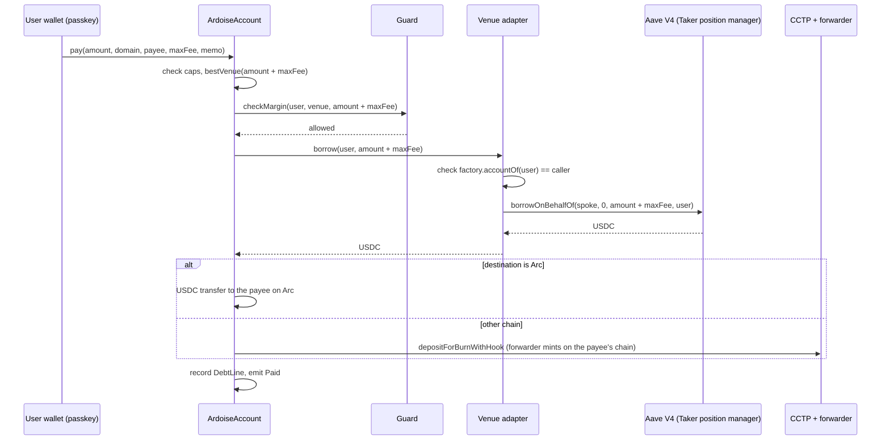

# Contract interfaces

The interfaces below are the single contact point between the tracks (see [`roadmap.md`](roadmap.md), task 0.4). They are frozen: changing one means telling the others first. The NatSpec in each file is the reference; this page explains how they fit together.

| Interface | File | Implemented by | Used by |
|-----------|------|----------------|---------|
| `IVenue` | [`contracts/src/interfaces/IVenue.sol`](../contracts/src/interfaces/IVenue.sol) | `AaveV4Adapter` (A1), Morpho adapter (R5) | `ArdoiseAccount`, guard, app (rate comparison, margin gauge) |
| `IArdoise` and `DebtLine` | [`contracts/src/interfaces/IArdoise.sol`](../contracts/src/interfaces/IArdoise.sol) | `ArdoiseAccount` (A2, A3) | app (pay screen, statement), keeper |
| `IArdoiseFactory` | [`contracts/src/interfaces/IArdoiseFactory.sol`](../contracts/src/interfaces/IArdoiseFactory.sol) | factory (A2) | venue adapters (caller check), app and keeper (finding a user's account) |
| `IGuard` | [`contracts/src/interfaces/IGuard.sol`](../contracts/src/interfaces/IGuard.sol) | guard (B1) | `ArdoiseAccount.pay()`, app, keeper |

## Units

| Quantity | Unit |
|----------|------|
| Token amounts | Token decimals (USDC: 6, cirBTC: 8) |
| Borrow rates | Yearly rate in basis points (1 bps = 0.01%) |
| Health factors | WAD (1e18 = 1.0, liquidation below 1.0); `type(uint256).max` without debt |
| USD values | WAD (1e18 = 1 USD) |
| Payees | `bytes32`, left-padded EVM address, as CCTP expects |
| Chains | CCTP domain ids (Arc = 26, Base = 6) |

## Who owns what

- **The collateral stays in the user's wallet.** The cirBTC position on Aave V4 belongs to the user's address, not to Ardoise. On Aave V4, Ardoise can only borrow within the allowance the user granted and repay; it can never withdraw collateral. On Morpho (R5), the authorization a user grants also allows withdrawals, so that guarantee holds for Aave V4 only.
- **One `ArdoiseAccount` per user**, created by `IArdoiseFactory.createAccount()`. The app and the keeper find it with `accountOf(user)` or the `AccountCreated` event. It holds the debt lines, the caps and any USDC waiting to repay debt. A plain USDC `transfer()` to the account runs no code, so `sweep()` lets anyone (the keeper included) apply that balance to the debt. `sweep()` is implemented in A2 (Track A); the keeper (B2) depends on it.
- **The factory holds the venue list and the guard** that every account reads, so they can be redeployed without new accounts. Deployment order: factory, then adapters and guard (pointing to the factory), then `setVenues` and `setGuard`.
- **Venue adapters are shared.** An adapter only accepts `borrow` calls from `factory.accountOf(user)` and sends the tokens to the caller. It must never trust `IArdoise(msg.sender).owner()`: any contract can claim a victim as its owner.
- **Debt lines are USDC only** and their `accruedInterest` is an estimate; the venue's `debtOf` is what is actually owed. Borrowing EURC (R5) would need a new line format.
- **The price-drop simulator (B3)** is outside these interfaces: Track B decides where the simulated price lives, as long as the demo labels it as a simulation and `checkMargin` keeps reading the real oracle in normal use.

## Payment flow

## Implementation notes (`ArdoiseAccount`, `ArdoiseFactory`)

Behaviour the frozen interfaces leave open, as implemented in [`ArdoiseAccount.sol`](../contracts/src/ArdoiseAccount.sol) and [`ArdoiseFactory.sol`](../contracts/src/ArdoiseFactory.sol), checked on Arc mainnet (see the A2 row in [`roadmap.md`](roadmap.md)).

- **Line ids start at 1** and follow payment order; `lines()` returns them oldest first.
- **CCTP:** payments to another chain call `depositForBurnWithHook(amount + maxFee, domain, payee, USDC, bytes32(0), maxFee, 2000, "cctp-forward")` on the TokenMessengerV2 `0x28b5a0e9C621a5BadaA536219b3a228C8168cf5d`. 2000 (standard finality) is what Circle documents for Arc as a source: attested in about 0.5 s, with no separate fast transfer. On mainnet, an Arc → Base payment was minted on Base 6 s after the Arc block.
- **The whole `maxFee` is charged.** On mainnet, a payment with `maxFee` 0.06 USDC delivered exactly `amount` on Base (`feeExecuted` = 0.06) while Circle quoted about 0.054. Despite the `Paid` NatSpec, the unused part of `maxFee` does not reach the payee with the Forwarding Service: the app should set `maxFee` to the `forwardFee.high` quoted by `GET https://iris-api.circle.com/v2/burn/USDC/fees/26/<domain>?forward=true`, plus the protocol fee, rounded up.
- **Payees:** every domain needs a left-padded EVM address except the known non-EVM CCTP domains (Noble 4, Solana 5, Sui 8, Aptos 9), which accept all 32 bytes.
- **Errors beyond the interface:** `ZeroAmount`, `FeeOnArc(maxFee)` (a payment on Arc must pass `maxFee` 0), `BorrowShortfall(expected, received)`, `Reentrancy`, `TokenCallFailed` on the account; `NotAdmin(caller)`, `InvalidVenue(venue)` (the venue does not lend the factory's USDC or does not trust this factory) and `ZeroAddress` on the factory.
- **Caps** apply to `amount + maxFee`; the UTC day is `block.timestamp / 1 days`. New accounts get the factory's `defaultPerPaymentCap` and `defaultDailyCap`.
- **Venue choice:** `bestVenue` skips venues whose `available()` or `rate()` reverts; ties go to the first venue in the factory's list.
- **Interest estimate:** simple interest at `rateBps` on the principal since `openedAt`, rounded down. A line closes when its repayments cover principal plus estimate, or when the owner's debt on its venue reaches 0. A closed line's `accruedInterest` is what was repaid beyond the principal.
- **Repayment:** `repay` pulls at most what the line owes by its estimate and refunds what the venue does not take.
- **`sweep()`** repays the open lines oldest first, skipping a line whose venue refuses the repayment instead of reverting, so the keeper is never stuck behind one line. What is left then repays the owner's remaining debt on each venue of the factory (venues compound a variable rate while line estimates use simple interest, and the owner may have debt opened outside Ardoise); anything left after that stays in the account. It does not read the guard, so it keeps working while the factory has none.
- **Closed lines:** `DebtLine` has no closed flag, and a line closed because its venue debt reached 0 can show `repaid` below `principal`. The account exposes `closed(lineId)` (not part of `IArdoise`) for the statement.
- **Trust:** the factory admin is trusted. Accounts borrow from, and approve repayments to, whatever venues the admin sets, and pay only if the admin's guard agrees.
- **Without a guard** (`setGuard(0)`), `pay()` reverts; repayments and `sweep()` still work.

## One-time user setup on Aave V4

Verified on Arc mainnet in test 0.1 (see the results in [`roadmap.md`](roadmap.md)).

1. Supply cirBTC on the Main Spoke (`supply(2, amount, user)`) and enable it as collateral (`setUsingAsCollateral(2, true, user)`).
2. Authorize the Aave position managers on the Main Spoke: `setUserPositionManager(TakerPositionManager, true)` to borrow on the user's behalf, `setUserPositionManager(GiverPositionManager, true)` to repay on the user's behalf.
3. Give the Aave adapter a borrow allowance: `TakerPositionManager.approveBorrow(MainSpoke, 0, AaveV4Adapter, cap)`. The allowance decreases by the actual debt increase. Use a finite cap (for example the daily cap times a few days) rather than `type(uint256).max`: the adapter is shared by every user.

The app runs these steps when the user activates their account.

## Aave V4 on Arc mainnet

| Contract | Address |
|----------|---------|
| Main Spoke | `0xB843bdC3a87A05E77E07Df9FE48928b3A34b134d` |
| Main Spoke oracle | `0x6ffE98F3422041236c19923EDB949F18A69e8A09` |
| TakerPositionManager (`borrowOnBehalfOf`) | `0xe9fae1C386c6f45B1fb3C3Ef01aDE424DAd4bCcF` |
| GiverPositionManager (`repayOnBehalfOf`) | `0x01Da80Eef3004ebbF90b7637B1De7fF30fBc7cf1` |
| USDC (reserve 0 on the Main Spoke) | `0x3600000000000000000000000000000000000000` |
| cirBTC (reserve 2 on the Main Spoke, collateral factor 78%) | `0x171A4217b86A807A64eB94757Db6849fb4bDbAA0` |

Source: [`aave-dao/aave-address-book`](https://github.com/aave-dao/aave-address-book/blob/main/src/AaveV4Arc.sol), checked on chain.

- `borrowOnBehalfOf(spoke, reserveId, amount, onBehalfOf)` sends the borrowed tokens to its caller (the adapter), which forwards them to the account.
- `repayOnBehalfOf` pulls the tokens from its caller and rejects `type(uint256).max`; pass the exact amount.
- A borrow through the Taker costs about 317k gas.
- `AaveV4Adapter.available()` is the Hub liquidity capped by the room left under the Main Spoke draw cap; on mainnet the draw cap is the binding limit (about 26.3M USDC on 2026-11-17). It returns 0 when the reserve is paused, frozen or not borrowable, or the Spoke is inactive or halted, so `pay()` can fall back to another venue.
- `AaveV4Adapter.rate()` is the Hub's base drawn rate; a cirBTC borrower also pays the Aave V4 risk premium of their position.
- `AaveV4Adapter.healthAfter()` uses the collateral factors the position was last refreshed with. A borrow refreshes them first, so right after governance lowers a collateral factor the projection can be higher than the health factor the borrow leaves.
