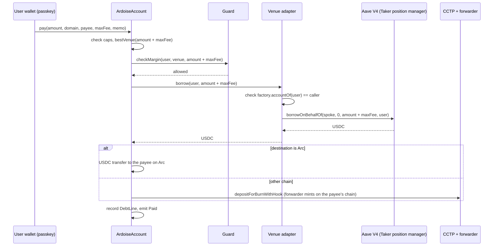

# Contract interfaces

The interfaces below are the single contact point between the tracks (see [`roadmap.md`](roadmap.md), task 0.4). They are frozen: changing one means telling the others first. The NatSpec in each file is the reference; this page explains how they fit together.

| Interface | File | Implemented by | Used by |
|-----------|------|----------------|---------|
| `IVenue` | [`contracts/src/interfaces/IVenue.sol`](../contracts/src/interfaces/IVenue.sol) | `AaveV4Adapter` (A1), Morpho adapter (R5) | `ArdoiseAccount`, guard, app (rate comparison, margin gauge) |
| `IArdoise` and `DebtLine` | [`contracts/src/interfaces/IArdoise.sol`](../contracts/src/interfaces/IArdoise.sol) | `ArdoiseAccount` (A2, A3) | app (pay screen, statement), keeper |
| `IArdoiseFactory` | [`contracts/src/interfaces/IArdoiseFactory.sol`](../contracts/src/interfaces/IArdoiseFactory.sol) | factory (A2) | venue adapters (caller check), app and keeper (finding a user's account) |
| `IGuard` | [`contracts/src/interfaces/IGuard.sol`](../contracts/src/interfaces/IGuard.sol) | `MarginGuard` (B1, B3) | `ArdoiseAccount.pay()`, app, keeper |

## Units

| Quantity | Unit |
|----------|------|
| Token amounts | Token decimals (USDC: 6, cirBTC: 8) |
| Borrow rates | Yearly rate in basis points (1 bps = 0.01%) |
| Health factors | WAD (1e18 = 1.0, liquidation below 1.0); `type(uint256).max` without debt |
| USD values | WAD (1e18 = 1 USD) |
| Payees | `bytes32`, left-padded EVM address, as CCTP expects |
| Chains | CCTP domain ids (Arc = 26, Base = 6) |

## Who owns what

- **The collateral stays in the user's wallet.** The cirBTC position on Aave V4 belongs to the user's address, not to Ardoise. On Aave V4, Ardoise can only borrow within the allowance the user granted and repay; it can never withdraw collateral. On Morpho (R5), the authorization a user grants also allows withdrawals, so that guarantee holds for Aave V4 only.
- **One `ArdoiseAccount` per user**, created by `IArdoiseFactory.createAccount()`. The app and the keeper find it with `accountOf(user)` or the `AccountCreated` event. It holds the debt lines, the caps and any USDC waiting to repay debt. A plain USDC `transfer()` to the account runs no code, so `sweep()` lets anyone (the keeper included) apply that balance to the debt. `sweep()` is implemented in A2 (Track A); the keeper (B2) depends on it.
- **The factory holds the venue list and the guard** that every account reads, so they can be redeployed without new accounts. Deployment order: factory, then adapters and guard (pointing to the factory), then `setVenues` and `setGuard`.
- **Venue adapters are shared.** An adapter only accepts `borrow` calls from `factory.accountOf(user)` and sends the tokens to the caller. It must never trust `IArdoise(msg.sender).owner()`: any contract can claim a victim as its owner.
- **Debt lines are USDC only** and their `accruedInterest` is an estimate; the venue's `debtOf` is what is actually owed. Borrowing EURC (R5) would need a new line format.
- **The price-drop simulator (B3)** is outside these interfaces: it lives in `MarginGuard` as an owner-only simulated drop, described in [Price-drop simulation](#price-drop-simulation-demo-only). The demo labels it as a simulation, and `checkMargin` reads the real oracle whenever the drop is 0.

## Payment flow



## Implementation notes (`ArdoiseAccount`, `ArdoiseFactory`)

Behaviour the frozen interfaces leave open, as implemented in [`ArdoiseAccount.sol`](../contracts/src/ArdoiseAccount.sol) and [`ArdoiseFactory.sol`](../contracts/src/ArdoiseFactory.sol), checked on Arc mainnet (see the A2 row in [`roadmap.md`](roadmap.md)).

- **Line ids start at 1** and follow payment order; `lines()` returns them oldest first.
- **CCTP:** payments to another chain call `depositForBurnWithHook(amount + maxFee, domain, payee, USDC, bytes32(0), maxFee, 2000, "cctp-forward")` on the TokenMessengerV2 `0x28b5a0e9C621a5BadaA536219b3a228C8168cf5d`. 2000 (standard finality) is what Circle documents for Arc as a source: attested in about 0.5 s, with no separate fast transfer. On mainnet, an Arc → Base payment was minted on Base 6 s after the Arc block.
- **The whole `maxFee` is charged.** On mainnet, a payment with `maxFee` 0.06 USDC delivered exactly `amount` on Base (`feeExecuted` = 0.06) while Circle quoted about 0.054. Despite the `Paid` NatSpec, the unused part of `maxFee` does not reach the payee with the Forwarding Service: the app should set `maxFee` to the `forwardFee.high` quoted by `GET https://iris-api.circle.com/v2/burn/USDC/fees/26/<domain>?forward=true`, plus the protocol fee, rounded up.
- **Payees:** every domain needs a left-padded EVM address except the known non-EVM CCTP domains (Noble 4, Solana 5, Sui 8, Aptos 9), which accept all 32 bytes.
- **Errors beyond the interface:** `ZeroAmount`, `FeeOnArc(maxFee)` (a payment on Arc must pass `maxFee` 0), `BorrowShortfall(expected, received)`, `GuardNotSet`, `Reentrancy`, `TokenCallFailed` on the account; `NotAdmin(caller)`, `InvalidVenue(venue)` (the venue does not lend the factory's USDC or does not trust this factory) and `ZeroAddress` on the factory.
- **Caps** apply to `amount + maxFee`; the UTC day is `block.timestamp / 1 days`. New accounts get the factory's `defaultPerPaymentCap` and `defaultDailyCap`.
- **Venue choice:** `bestVenue` skips venues whose `available()` or `rate()` reverts; ties go to the first venue in the factory's list.
- **Interest estimate:** simple interest at `rateBps` on the principal since `openedAt`, rounded down. A line closes when its repayments cover principal plus estimate, or when the owner's debt on its venue reaches 0. A closed line's `accruedInterest` is what was repaid beyond the principal.
- **Repayment:** `repay` pulls at most what the line owes by its estimate and refunds what the venue does not take.
- **`sweep()`** repays the open lines oldest first, skipping a line whose venue refuses the repayment instead of reverting, so the keeper is never stuck behind one line. What is left then repays the owner's remaining debt on each venue of the factory (venues compound a variable rate while line estimates use simple interest, and the owner may have debt opened outside Ardoise); anything left after that stays in the account. That second pass credits no line, so a closed line can show less interest than the venue actually charged, and a line skipped earlier in the same sweep only shows as closed after the next `sweep()` or `repay(lineId, 0)`. A line whose venue keeps refusing is retried, at a gas cost, on every sweep. It does not read the guard, so it keeps working while the factory has none.
- **Closed lines:** `DebtLine` has no closed flag, and a line closed because its venue debt reached 0 can show `repaid` below `principal`. The account exposes `closed(lineId)` (not part of `IArdoise`) for the statement.
- **Trust:** the factory admin is trusted. Accounts borrow from, and approve repayments to, whatever venues the admin sets, and pay only if the admin's guard agrees.
- **Without a guard** (for example after `setGuard(0)`), `pay()` reverts with `GuardNotSet()`; repayments and `sweep()` still work.

## Price-drop simulation (demo only)

`MarginGuard` ([`contracts/src/guard/MarginGuard.sol`](../contracts/src/guard/MarginGuard.sol)) can reason as if the collateral price had dropped, so that the demo can show a payment being refused and a repayment restoring the margin without waiting for the market. These members are additions of the implementation, not part of the frozen `IGuard`:

| Member | Use |
|--------|-----|
| `simulatedDropBps()` | Simulated drop in basis points; `0` means the simulation is off (the normal state). The app shows a "SIMULATION — BTC -x%" banner whenever it is not 0 |
| `simulatedHealth(venue, user)` | Health factor as the guard sees it (WAD, `type(uint256).max` without debt): the venue's health factor scaled by `(10_000 - simulatedDropBps) / 10_000`. The margin gauge reads this instead of `venue.health(user)` |
| `setSimulatedDrop(dropBps)` | Owner only, at most `MAX_SIMULATED_DROP_BPS` (`9_000`, 90%). Emits `SimulationUpdated(dropBps)`; reverts with `NotOwner(caller)` or `InvalidSimulatedDrop(dropBps)` |

- **What it changes:** only Ardoise's own decisions. `checkMargin` refuses or reduces payments as if the price had dropped, and the keeper judges positions with the same simulated health factor.
- **What it never changes:** Aave, its oracle and the user's real position. Nobody can be liquidated because of the simulation, and `venue.health(user)` keeps returning the real numbers.
- **It is global:** the guard is shared by every account of the factory, so a non-zero drop refuses or reduces payments for every user, not only the demo one, until the owner sets it back to 0. It can only make the guard stricter: it never lets through a payment the real guard would refuse. After a demo, check that `simulatedDropBps()` is 0.
- **Why scaling the health factor is right:** it is risk-adjusted collateral over debt, so with cirBTC as the only collateral a price drop of x% multiplies it by (1 - x%), up to rounding dust. With several collateral assets the simulation means "every collateral -x%", which is stricter than a drop of BTC alone.
- **Gauge and payments:** `simulatedHealth` derives from `venue.health`, `checkMargin` from `venue.healthAfter`; they may differ by a few wei, so a gauge exactly at the minimum does not guarantee that a payment passes.
- **Outside the demo** the drop stays at 0 and `checkMargin` reads the real oracle through the venue, at the same gas cost as without the feature.

## Gateway standing orders (B4)

A user who keeps USDC in Circle Gateway on Base can let the keeper repay their debt from it when a position falls under the guard's minimum and the account holds nothing to repay with.

- **Standing order:** a Gateway burn intent the owner signs in advance (EIP-712, domain `GatewayWallet` version `1`): a fixed `value` of their Gateway balance on Base (domain 6), delivered on Arc (domain 26) to **their own Ardoise account**, with `destinationCaller` zero so that Circle's forwarder can mint, and no hook data. Gateway accepts a `maxBlockHeight` up to about 70 days ahead on Base, so orders are renewed every few weeks.
- **Keeper:** reads orders from `GATEWAY_ORDERS_FILE` (a JSON array of `{ burnIntent, signature }` with addresses as left-padded bytes32; a malformed entry is skipped). For `decide()`'s shortfall it submits the smallest unused order that covers it, or else the fewest, to `POST /v1/transfer?enableForwarder=true`, follows each transfer, and sweeps the USDC into the debt on a later pass. It refuses any order whose recipient is not the owner's account (the pair from the factory's `AccountCreated` event), whose depositor is not the owner, or that uses other contracts, tokens or domains (`rejectReason` in [`keeper/src/gateway.ts`](../keeper/src/gateway.ts)). An order Gateway refuses for another reason than a spent salt (balance not credited yet, server error, timeout) is retried with a growing delay. Without `KEEPER_PRIVATE_KEY` the keeper runs dry and submits no order either, although submitting needs no key.
- **From the app:** the Protection panel ([`app/src/components/ProtectionPanel.tsx`](../app/src/components/ProtectionPanel.tsx), [`app/src/lib/gateway.ts`](../app/src/lib/gateway.ts)) shows the Gateway balance on Base and deposits into it (approve + `GatewayWallet.deposit` on Base), has the wallet sign standing orders (signatures only, no gas) and posts them to the keeper, and offers a one-click repayment: one order submitted to Gateway right away, delivered on the account, then applied with `sweep()`.
- **Keeper intake:** `POST /orders` on `GATEWAY_INTAKE_PORT` stores an order only if its recipient is `factory.accountOf(depositor)`, it passes `rejectReason` (signer and depositor are the owner), and the signature is the depositor's, verified on Base (EOA or ERC-1271). Chain checks run before the write lock; at most 10 orders per request and 40 live orders per owner, checked before any chain read; expired and used orders are dropped. `GET /orders?owner=` lists live orders as summaries (value, expiry, salt) without signatures. It listens on `127.0.0.1` only, with CORS limited to `APP_ORIGIN`: a browser on the keeper's machine can reach it, a hosted app cannot as is. Chain or file failures are answered with a generic 503 so that no RPC URL leaks ([`keeper/src/intake.ts`](../keeper/src/intake.ts)).
- **Bearer orders:** a signed standing order can be submitted to Gateway by whoever holds it. It can only move the owner's reserve onto their own account, repaying their debt for Gateway's fee, which is why the intake never returns signatures. Standing orders are signed with twice Gateway's estimated fee cap, since they may be used weeks later; Gateway charges only the actual fee. The keeper remembers used orders in memory only: after a restart, orders spent before it are listed as live until the funder tries one and Gateway reports it spent.
- **Why it is safe:** an order can only pay the account it names, and that account can only repay its owner's debt, so the keeper holds no key that can move user funds and a leaked order can do nothing but repay that debt. Gateway checks the signature (ERC-1271 for smart contract wallets).
- **Cost:** on mainnet, Gateway quoted 0.0248 USDC for a 5 USDC order from Base to Arc (0.01 Gateway fee + 0.0148 forwarding).

## One-time user setup on Aave V4

Verified on Arc mainnet in test 0.1 (see the results in [`roadmap.md`](roadmap.md)).

1. Supply cirBTC on the Main Spoke (`supply(2, amount, user)`) and enable it as collateral (`setUsingAsCollateral(2, true, user)`).
2. Authorize the Aave position managers on the Main Spoke: `setUserPositionManager(TakerPositionManager, true)` to borrow on the user's behalf, `setUserPositionManager(GiverPositionManager, true)` to repay on the user's behalf.
3. Give the Aave adapter a borrow allowance: `TakerPositionManager.approveBorrow(MainSpoke, 0, AaveV4Adapter, cap)`. The allowance decreases by the actual debt increase. Use a finite cap (for example the daily cap times a few days) rather than `type(uint256).max`: the adapter is shared by every user.

The app runs these steps when the user activates their account.

## Aave V4 on Arc mainnet

| Contract | Address |
|----------|---------|
| Main Spoke | `0xB843bdC3a87A05E77E07Df9FE48928b3A34b134d` |
| Main Spoke oracle | `0x6ffE98F3422041236c19923EDB949F18A69e8A09` |
| TakerPositionManager (`borrowOnBehalfOf`) | `0xe9fae1C386c6f45B1fb3C3Ef01aDE424DAd4bCcF` |
| GiverPositionManager (`repayOnBehalfOf`) | `0x01Da80Eef3004ebbF90b7637B1De7fF30fBc7cf1` |
| USDC (reserve 0 on the Main Spoke) | `0x3600000000000000000000000000000000000000` |
| cirBTC (reserve 2 on the Main Spoke, collateral factor 78%) | `0x171A4217b86A807A64eB94757Db6849fb4bDbAA0` |

Source: [`aave-dao/aave-address-book`](https://github.com/aave-dao/aave-address-book/blob/main/src/AaveV4Arc.sol), checked on chain.

- `borrowOnBehalfOf(spoke, reserveId, amount, onBehalfOf)` sends the borrowed tokens to its caller (the adapter), which forwards them to the account.
- `repayOnBehalfOf` pulls the tokens from its caller and rejects `type(uint256).max`; pass the exact amount.
- A borrow through the Taker costs about 317k gas.
- `AaveV4Adapter.available()` is the Hub liquidity capped by the room left under the Main Spoke draw cap; on mainnet the draw cap is the binding limit (about 26.3M USDC on 2026-11-17). It returns 0 when the reserve is paused, frozen or not borrowable, or the Spoke is inactive or halted, so `pay()` can fall back to another venue.
- `AaveV4Adapter.rate()` is the Hub's base drawn rate; a cirBTC borrower also pays the Aave V4 risk premium of their position.
- `AaveV4Adapter.healthAfter()` uses the collateral factors the position was last refreshed with. A borrow refreshes them first, so right after governance lowers a collateral factor the projection can be higher than the health factor the borrow leaves.

## Payment request links

A payee asks to be paid with a link to the app, built on `/request` and shared as is or as a QR code. Opening it fills in the pay screen; nothing is stored or sent on chain until the payer pays. Built and read by [`app/src/lib/paymentRequest.ts`](../app/src/lib/paymentRequest.ts).

```
https://<app>/app?to=<payee>&chain=<base|arc>&amount=<USDC>&memo=<text>&id=<request id>
```

| Parameter | Required | Value | If invalid |
|-----------|----------|-------|------------|
| `to` | yes | EVM address that receives the USDC; a mixed-case address must have a valid checksum | the whole request is ignored |
| `chain` | no | `base` or `arc` | `base` |
| `amount` | no | USDC as a decimal, more than 0, at most 6 decimals (`12.5`) | left empty for the payer to fill in |
| `memo` | no | Text for the payer's statement | bidirectional controls removed, cut to 120 characters |
| `id` | no | Random id set when the request is created, 8 to 32 lowercase letters and digits | ignored |

- **The link comes from the payee, not from Ardoise.** The pay screen shows the full payee address and asks the payer to check it, since a shortened address is easy to imitate.
- **One payment per opening.** Once the payment is sent, the app drops the request from the page and its address, so reloading does not fill in the same payment again.

### Confirmation on the payee's side

After creating a request, the payee's page waits for the payment ([`app/src/lib/requestWatch.ts`](../app/src/lib/requestWatch.ts)):

- **Real payments:** it reads USDC `Transfer` logs to the payee on the requested chain, from the block the request was created at. The read runs every 4 s, backing off up to 30 s when the RPC throttles, in steps of 2,000 blocks.
  - **Re-read tail:** each check re-reads the last 20 blocks, since a load-balanced RPC can serve logs from a node a few blocks behind.
  - **What confirms:** the first transfer of at least the requested amount confirms the request. Without an amount, any transfer of at least 0.01 USDC does; smaller "address poisoning" dust is ignored.
  - **What the page shows:** the amount, the sender and the transaction. A payment to Base is minted by Circle's forwarder, so its sender is the zero address (checked on the first mainnet payment) and it is shown as "Delivered by Circle (CCTP)".
  - **Arc limit:** on Arc, a payment from Ardoise is an ERC-20 `transfer` and emits the event. USDC sent as Arc's native gas token in a transaction's value may not emit it, so it may not be seen.
  - **Any transfer counts:** the check reads the chain itself, so it confirms any transfer to the payee, whoever sends it. Two payments of the same amount to the same address cannot be told apart, which is why only blocks after the request count.
  - **Base RPC:** logs on Base are read through publicnode's public RPC, because Base's own public RPC refuses `eth_getLogs`.
- **Demo payments:** the demo account moves nothing on chain. When it pays a request whose payee, chain and amount it matches, it publishes `{"type":"paid","simulated":true}` on the request's live session (below). The waiting page then shows "Demo payment reported: no USDC was received", never its received view, since anyone holding the link can publish that message.
- **Editing a request** keeps its id and start block as long as the payee and chain stay the same, so the link already shared still works and a payment made meanwhile still counts.
- **Privacy:** the reads go from the visitor's browser to public RPCs (publicnode for Base, Arc's own RPC) and to ntfy.sh, which see the payee address or the request's id, and the visitor's IP.

### Live session

A request with an `id` has a live session between the payee's waiting page and the payer's pay screen ([`app/src/lib/requestSession.ts`](../app/src/lib/requestSession.ts)). The app is hosted on Vercel, which cannot hold WebSockets, so both pages go through [ntfy.sh](https://ntfy.sh), a public pub/sub relay. They use the topic `ardoise-req-<id>`: they publish with `POST`, and subscribe over a WebSocket with `since=all`, which first replays the events the relay kept (12 hours), then streams new ones.

| Event (JSON body) | Sent by | Meaning |
|-------------------|---------|---------|
| `{"type":"joined"}` | payer, on opening the link (not the payee's own "Open as the payer" preview, which carries `preview=1`) | starts the payer's 30 s on the relay's clock; each side corrects for its own clock with the offset it measures on an event that just arrived |
| `{"type":"cancelled"}` | payee | closes the request |
| `{"type":"expired"}` | payee, when the 30 s end without a payment | closes the request |
| `{"type":"paid","simulated":false}` | payee, once the USDC is seen on chain in time | informational; the payer's screen has already moved to its receipt and does not read it |
| `{"type":"paid","simulated":true}` | payer, after a demo payment that matches the request | shown on the payee's page as a demo report, not as money received |

- **The first event of each kind wins.** A second payer opening the link does not restart the 30 s, and nothing reopens a closed request.
- **Closing a request stops payments, but only through Ardoise's own screen.** Once a request is cancelled or its 30 s are over, the payer's Pay button is disabled, and a dropped connection does not enable it again. A transfer on chain cannot be refused, though. If one lands more than 60 s after the request closed, the payee's page shows it as "Paid after the request closed" and asks the payee to refund it if they do not accept it. The request closed at the earlier of the cancel or expiry message and the deadline. The 60 s cover a payment sent just before the end and delivered by CCTP a few seconds later.
- **Statuses only, nothing confirmed by them.** Messages carry statuses only, never an address or an amount. Anyone with the link can read the topic or publish to it. A real payment is only confirmed on chain, so a forged message can at most:
  - show a demo report;
  - start the payer's 30 s before they open the link;
  - close the request early.
- **The 30 s limit is cooperative.** It is enforced by Ardoise's own pay screen, not on chain, and only once the payer's opening reached the relay. A payer who opens the link with `preview=1`, or blocks ntfy.sh, never starts it. No expiry message is sent then, so only a cancel can make their payment late; the payee still sees it on chain.
- **Clock offset.** Each side estimates the relay's clock as the largest `relay time − receive time` of the events it receives. A replayed event (after a reload) gives a lower value, so it does not restart the 30 s once a live event arrives; the payer's own `joined` echo provides one.
- **A demo report can be set aside.** The payee's "Demo payment reported" view has a "Back to the request" button, so a forged report does not take the link, QR code and Cancel away.
- **If the relay is unreachable** before the session is known, both pages say so within 6 s. The payer can then pay without a time limit, and the payee's page still confirms the payment on chain.
- **The relay's limits apply.** ntfy.sh limits anonymous requests per IP, which a shared network (conference Wi-Fi) could reach. A failed cancel is reported to the payee so they can retry.
